# Database Architecture & Core Domain Data Model Specification

**Document Version:** 1.6.0  
**Phase:** Database Architecture Integrity & Final Sign-off (TASK 002.6)  
**Target Engine:** PostgreSQL 16  
**ORM / Data Layer:** SQLAlchemy 2.x (Async) & Alembic  
**Caching & Ephemeral Layer:** Redis 7 (Async via `redis.asyncio`)  
**Timezone Standard:** Storage strictly in UTC (`TIMESTAMPTZ`); Business logic evaluated in `Asia/Tehran`  

---

## 1. Architectural Overview & Design Principles

The Anonymous Telegram Matching & Chat Bot is engineered as a **Modular Monolith** in asynchronous Python 3.12+. All user interactions, media proxying, administration, and support workflows execute **exclusively inside Telegram** through the Telegram Bot API (`aiogram 3.x`). There is no web frontend, web admin panel, or browser UI.

### Core Design Principles

1. **Strict Identity Isolation & Privacy by Design**:
   - The private 64-bit Telegram User ID (`telegram_user_id`) is stored exclusively in the root `users` table. It is never exposed in profile lookups, matching queries, API responses, or bot messages.
   - Every user possesses an immutable, non-sequential alphanumeric `public_id` (e.g., `usr_7k9x2m4p8q1v`). Peer interactions, direct link requests, and profile exchanges reference `public_id` exclusively.
   - Phone numbers are never requested, ingested, or stored.
   - User identity verification badges do not exist. Users explicitly self-declare adult eligibility ($\ge 18$) upon registration (`age_18_plus_declared`).
   - Authoritative declaration timestamp `users.age_declared_at` is generated **exclusively by the database engine clock** (`clock_timestamp()`) upon the first transition to `age_18_plus_declared = TRUE`. Any caller-supplied timestamp is discarded on both `INSERT` and `UPDATE`. `users.age_declared_date` is derived exclusively from this database-generated timestamp in `Asia/Tehran`. A composite foreign key `(user_id, age_18_plus_declared, age_declared_date)` on `user_profiles` physically prevents profile creation for undeclared users and ensures zero contradiction. Database triggers enforce permanent immutability, preventing backdated, future-dated, or fabricated declarations from bypassing age eligibility checks.
2. **Clear Responsibility Boundary: PostgreSQL vs. Redis**:
   - **PostgreSQL 16**: Authoritative persistent system of record for user accounts, profiles, matching preferences, permanent connections, blocks, chat sessions, message metadata, normalized evidence holds, audit logs, reports, dynamic configuration, and the immutable financial ledger.
   - **Redis 7**: Ephemeral matchmaking queues, active waiting pools, live typing indicators, distributed concurrency locks, rate limits, and finite state machine (FSM) conversational wizard state.
3. **Single-Table Append-Only Financial Ledger & Traceable Allowances**:
   - The ledger (`wallet_ledgers`) is an append-only transaction journal (not double-entry). Balance changes require row-level locking (`SELECT ... FOR UPDATE`) within ACID transactions, accompanied by immutable journal entries carrying unique idempotency keys.
   - Every transaction consuming or modifying daily free credits is strictly traceable to the exact `wallet_daily_allowances` record via a composite foreign key referencing `(allowance_id, wallet_user_id, allowance_date)`.
   - Free credits are consumed before purchased credits.
   - Daily free credits expire strictly at midnight in the `Asia/Tehran` timezone without carryover. Purchased credits never expire.
   - The daily free quota is dynamically configurable by Super Admins via `system_configurations` (no hardcoded fixed quota).
   - Financial operations are strictly encapsulated within the `Wallet Service`. No direct balance modifications from matchers or chat routers are permitted.
4. **Conditional Deferred Chat Billing & Immutable Direct Chat Origin**:
   - Connecting participants is always free. Charges occur **only after both participants have sent at least one message**.
   - Random chat costs 1 coin per participant.
   - Direct chat sessions require an originating request in `ACCEPTED` status, strictly guaranteed at the database engine level via a composite foreign key referencing `direct_requests(id, status, requester_id, target_id)`.
   - Direct chat origin, participants, and request linkage are **permanently immutable post-creation** via database trigger (`trg_chat_sessions_lifecycle_guard`). The database prevents mutating a `DIRECT` session into `RANDOM`, reassigning participants, or nullifying the request reference to bypass accepted-request protections, while preserving legitimate lifecycle mutations (status, message flags, charging state, termination timestamps).
   - Direct chat settlement charges exactly 2 coins to `direct_requests.requester_id` (authoritatively resolved from the direct request record, independent of participant join ordering); the recipient pays 0 coins.
   - If mutual participation never occurs before chat termination, neither participant is charged.
   - Direct request creation and acceptance are completely free.
   - All financial debits, ledger recordings, and chat session state updates occur within a **single atomic database transaction**.
5. **Zero VPS Media Persistence & Strict Video Ceiling**:
   - The bot relays media using Telegram `file_id` references. No images, audio files, voice notes, or videos are downloaded or permanently stored on the host server disk.
   - Video payloads of 10 MB or larger ($10{,}485{,}760\text{ bytes}$) must always be rejected. Application validation and database schema constraints strictly enforce a less-than comparison (`file_size_bytes < 10485760`).
6. **Bounded Message Retention, Session-Consistent Evidence Holds & Audit Preservation**:
   - Routine message text and media metadata have a maximum normal retention period of **30 days** (`expires_at = created_at + INTERVAL '30 days'`).
   - A message may be placed under hold by multiple independent reports or legal orders via a normalized `message_evidence_holds` junction entity.
   - The database guarantees cross-table session consistency via database trigger (`trg_message_evidence_holds_guard`), physically rejecting any evidence hold where the cited message does not belong to the cited `chat_session_id`.
   - Resolving one report releases only its own hold; message content is eligible for routine scrubbing only after all active holds are released.
   - Every hold and hold release enforces verifiable actor attribution (human admin or explicit system actor identifier) and mandatory justification.
   - Legal holds without user reports are fully supported and retain stable legal order references (`legal_reference_id`).
   - When an expired message is scrubbed, `message_evidence_holds.message_id` is set to `NULL` (`ON DELETE SET NULL`), scrubbing message text and media IDs while permanently preserving hold creation and release audit metadata, durable session context (`chat_session_id NOT NULL REFERENCES chat_sessions(id) ON DELETE RESTRICT`), and cryptographic message fingerprint (`message_content_hash`).
   - Access to held evidence is restricted strictly to authorized moderators.
7. **Complete Bidirectional Block Enforcement**:
   - A block between two users strictly prevents all communication, discovery, and requests in **both directions**.
   - If either user blocks the other during an active chat, the chat terminates immediately (`end_reason = 'BLOCKED'`) and message routing halts.
8. **Asymmetric Connection Removal**:
   - When User A removes User B from their contacts, only User A's connection record is updated. User B's record remains untouched. This action does not block either user.
9. **Persistent Admin Configuration with Overflow-Safe Upper Bounds**:
   - All operational settings are durably stored in `system_configurations` with complete audit trails in `admin_audit_logs`.
   - Hard upper bounds are enforced directly at the schema level using regex-validated integer checks: `video_size_limit_bytes` can never exceed $10{,}485{,}760\text{ bytes}$, and `message_retention_days` can never exceed 30 days. Regex pre-validation guarantees string length and integer format before casting, eliminating SQL numeric overflow errors regardless of evaluation order.
   - Financial adjustments and configuration updates are restricted exclusively to `SUPER_ADMIN`.
10. **Non-Reversible Account Deletion Pseudonymization**:
    - Account deletion severs personal identity by replacing `telegram_user_id` with a cryptographically secure, strictly negative 63-bit surrogate integer.
    - Status is set to `'DELETED'`, and profile PII is scrubbed.
    - Financial ledger records are preserved for auditability via `ON DELETE RESTRICT`.
    - A returning Telegram user registers as a completely new account with zero linkage to the deleted account.

---

## 2. PostgreSQL vs. Redis Responsibility Matrix

| Domain Concern | PostgreSQL 16 (Durable System of Record) | Redis 7 (Ephemeral Cache / Locks / Queues) |
| :--- | :--- | :--- |
| **User Identity** | `users`, `user_profiles` | Cached user permission tier & ban flags (TTL: 10m) |
| **System Settings** | `system_configurations` (Durable store with validated bounds) | Cached configuration lookup (`config:<key>`, TTL: 5m) |
| **Matching Preferences** | `user_preferences` (required & relaxable) | Demographic indexed candidate pools |
| **Matchmaking Queue** | Historical match metrics & connection logs | Active waiting queues (Sorted Sets / Streams) |
| **Active Chat Session** | `chat_sessions` (linked to `direct_requests`), `active_chat_participants` | Active partner mapping (`user_id -> chat_id`, `partner_id`) |
| **Chat Invariants** | Unique participant constraint in active chats | Concurrency locks (`lock:chat:settle:<chat_id>`) |
| **Message Routing** | `chat_messages` metadata & retention deadlines | Live message rate-limiting (`ratelimit:<user_id>:msgs`) |
| **Evidence Preservation** | `message_evidence_holds` (Audit-preserving multi-holds) | Moderator access authorization tokens |
| **Typing Indicators** | Not persisted | Ephemeral Pub/Sub events (`chat:<chat_id>:typing`) |
| **Financial Balances** | `wallets`, `wallet_daily_allowances` | Cached balance display (`wallet:<user_id>:bal`) |
| **Transaction Ledger** | `wallet_ledgers` (Append-only journal) | Distributed lock `lock:wallet:<user_id>` |
| **User Blocks** | `user_blocks` (Permanent bidirectional store) | Fast Set lookup `blocks:<user_id>` |
| **FSM Wizard State** | Incomplete profile drafts (durable save) | Active conversational step (`fsm:<user_id>:state`) |

---

## 3. Entity Relationship Diagram (Mermaid)

```mermaid
erDiagram
    users ||--|| user_profiles : "has profile"
    users ||--|| user_preferences : "configures"
    users ||--|| wallets : "owns balance"
    users ||--o{ wallet_daily_allowances : "receives daily"
    users ||--o{ wallet_ledgers : "audited by"
    users ||--o{ user_blocks : "initiates blocker"
    users ||--o{ user_blocks : "targeted as blocked"
    users ||--o{ direct_requests : "sends as requester"
    users ||--o{ direct_requests : "receives as target"
    users ||--o{ user_connections : "keeps connection"
    users ||--o{ user_connections : "connected to"
    users ||--o{ active_chat_participants : "currently in"
    users ||--o{ reports : "submits report"
    users ||--o{ reports : "reported against"
    users ||--o{ moderation_actions : "receives sanction"
    users ||--o| admin_users : "assigned role"
    admin_users ||--o{ admin_audit_logs : "records action"
    admin_users ||--o{ system_configurations : "updates config"

    direct_requests ||--o| chat_sessions : "accepted request originates"

    chat_sessions ||--o{ active_chat_participants : "active members"
    chat_sessions ||--o{ chat_messages : "contains messages"
    chat_sessions ||--o{ reports : "cited in"

    chat_messages ||--o{ message_evidence_holds : "preserved under"
    chat_sessions ||--o{ message_evidence_holds : "durable session context"
    reports ||--o{ message_evidence_holds : "establishes hold"

    wallet_daily_allowances ||--o{ wallet_ledgers : "reconciles free credit"

    users {
        bigint id PK
        bigint telegram_user_id UK "Private or Random Negative Surrogate"
        varchar public_id UK "Public Identifier"
        varchar status
        boolean age_18_plus_declared
        timestamptz age_declared_at "Authoritative UTC declaration timestamp"
        date age_declared_date "Asia/Tehran calendar date of declaration"
        timestamptz created_at
        timestamptz last_activity_at
        timestamptz deleted_at
    }

    user_profiles {
        bigint user_id PK "FK references users"
        boolean age_18_plus_declared "FK references users (Must be TRUE)"
        date age_declared_date "FK references users (Asia/Tehran date)"
        date birth_date
        varchar display_name
        varchar gender
        varchar city
        varchar bio
        varchar completion_status
        varchar visibility
        timestamptz updated_at
    }

    user_preferences {
        bigint user_id PK "FK references users"
        text_array preferred_genders
        smallint min_age
        smallint max_age
        text_array preferred_cities
        jsonb required_filters
        jsonb relaxable_filters
        timestamptz updated_at
    }

    direct_requests {
        bigint id PK
        bigint requester_id FK
        bigint target_id FK
        varchar status "PENDING, ACCEPTED, REJECTED, EXPIRED, CANCELLED"
        timestamptz expires_at
        timestamptz created_at
        timestamptz responded_at
    }

    user_connections {
        bigint id PK
        bigint user_id FK
        bigint connected_user_id FK
        varchar status
        timestamptz established_at
        timestamptz updated_at
    }

    user_blocks {
        bigint blocker_id PK "FK references users"
        bigint blocked_id PK "FK references users"
        varchar reason
        timestamptz created_at
    }

    chat_sessions {
        uuid id PK
        varchar chat_type
        bigint direct_request_id FK "Nullable, required for DIRECT chats"
        varchar direct_request_status "Always 'ACCEPTED' for DIRECT chats"
        bigint participant_one_id FK "Matches direct_requests.requester_id for DIRECT"
        bigint participant_two_id FK "Matches direct_requests.target_id for DIRECT"
        varchar status
        boolean participant_one_sent_msg
        boolean participant_two_sent_msg
        boolean is_charged
        timestamptz charged_at
        varchar end_reason
        timestamptz created_at
        timestamptz started_at
        timestamptz ended_at
    }

    active_chat_participants {
        bigint user_id PK "FK references users"
        uuid chat_id FK
        timestamptz joined_at
    }

    chat_messages {
        bigint id PK
        uuid chat_id FK
        bigint sender_id FK
        bigint recipient_id FK
        varchar message_type
        varchar content_hash
        varchar telegram_file_id
        bigint file_size_bytes
        integer duration_seconds
        timestamptz created_at
        timestamptz expires_at
    }

    message_evidence_holds {
        bigint id PK
        bigint message_id FK "Nullable on message content deletion (ON DELETE SET NULL)"
        uuid chat_session_id FK "Durable session reference (ON DELETE RESTRICT)"
        varchar message_content_hash "Cryptographic fingerprint of held message"
        bigint report_id FK "Nullable for legal holds"
        varchar legal_reference_id "Required for legal holds"
        varchar hold_type "USER_REPORT, LEGAL_HOLD, SAFETY_AUDIT"
        varchar status "ACTIVE, RELEASED"
        text reason "Mandatory hold justification"
        bigint created_by_admin_id FK "Nullable if system actor"
        varchar created_by_system_actor "Nullable if admin actor"
        timestamptz created_at
        bigint released_by_admin_id FK "Nullable if active or system actor"
        varchar released_by_system_actor "Nullable if active or admin actor"
        timestamptz released_at "Required if status is RELEASED"
        text release_notes "Required if status is RELEASED"
    }

    wallets {
        bigint user_id PK "FK references users"
        integer purchased_coins
        timestamptz created_at
        timestamptz updated_at
    }

    wallet_daily_allowances {
        bigint id PK
        bigint user_id FK
        date allowance_date "Asia/Tehran date"
        integer allocated_credits
        integer used_credits
        integer remaining_credits
        timestamptz expires_at
        timestamptz created_at
        timestamptz updated_at
    }

    wallet_ledgers {
        bigint id PK
        bigint wallet_user_id FK
        varchar idempotency_key UK
        varchar transaction_type
        varchar credit_type
        bigint allowance_id FK
        date allowance_date
        integer amount
        integer purchased_balance_before
        integer purchased_balance_after
        integer free_balance_before
        integer free_balance_after
        varchar reference_id
        varchar actor_type
        bigint actor_id FK
        text reason
        timestamptz created_at
    }

    system_configurations {
        varchar key PK
        jsonb value
        text description
        varchar category
        bigint updated_by FK
        timestamptz updated_at
    }

    reports {
        bigint id PK
        bigint reporter_id FK
        bigint reported_user_id FK
        uuid chat_session_id FK
        bigint reported_message_id FK
        varchar category
        text description
        varchar status
        bigint moderator_id FK
        timestamptz created_at
        timestamptz reviewed_at
        text resolution_notes
    }

    moderation_actions {
        bigint id PK
        bigint user_id FK
        varchar action_type
        bigint moderator_id FK
        bigint report_id FK
        text reason
        timestamptz expires_at
        timestamptz created_at
    }

    admin_users {
        bigint user_id PK "FK references users"
        varchar role
        boolean is_active
        bigint assigned_by FK
        timestamptz created_at
        timestamptz updated_at
    }

    admin_audit_logs {
        bigint id PK
        bigint admin_user_id FK
        varchar action
        varchar target_type
        varchar target_id
        jsonb payload_before
        jsonb payload_after
        text reason
        timestamptz created_at
    }
```



---

## 4. Comprehensive Table Specifications

### Domain Area A: User Accounts

#### Table: `users`
Represents the root identity record. Contains authentication routing metadata, account status, and authoritative adult self-declaration records.

| Column Name | PostgreSQL Type | Nullable | Default | Description |
| :--- | :--- | :--- | :--- | :--- |
| `id` | `BIGINT GENERATED ALWAYS AS IDENTITY` | **NO** | *Sequence* | Internal surrogate primary key. |
| `telegram_user_id` | `BIGINT` | **NO** | — | Private 64-bit signed Telegram ID. Replaced with cryptographically secure negative surrogate upon deletion. |
| `public_id` | `VARCHAR(32)` | **NO** | — | Non-sequential alphanumeric identifier (e.g. `usr_9k2m4x`). |
| `status` | `VARCHAR(20)` | **NO** | `'ACTIVE'` | `'ACTIVE'`, `'SUSPENDED'`, `'BANNED'`, `'DELETED'`. |
| `age_18_plus_declared` | `BOOLEAN` | **NO** | `FALSE` | Explicit declaration that user is $\ge 18$. Does not imply identity verification. |
| `age_declared_at` | `TIMESTAMPTZ` | YES | `NULL` | Authoritative UTC timestamp of explicit adult self-declaration. |
| `age_declared_date` | `DATE` | YES | `NULL` | Derived calendar date in `Asia/Tehran` at declaration time. |
| `created_at` | `TIMESTAMPTZ` | **NO** | `now()` | UTC account creation timestamp. |
| `last_activity_at` | `TIMESTAMPTZ` | **NO** | `now()` | UTC timestamp of last Telegram interaction. |
| `suspended_until` | `TIMESTAMPTZ` | YES | `NULL` | Timestamp until which the account is suspended. |
| `suspension_reason` | `TEXT` | YES | `NULL` | Internal note explaining the suspension. |
| `deleted_at` | `TIMESTAMPTZ` | YES | `NULL` | Soft-delete timestamp preserving ledger & audit integrity. |

- **Database-Authoritative Declaration Storage & Immutability Architecture**:
  1. **Authoritative Database Clock Assignment**: `age_declared_at` is generated **strictly by the PostgreSQL database engine clock** (`clock_timestamp()`) at the exact instant the declaration transition occurs. Any caller-supplied timestamp in `INSERT` or `UPDATE` statements is **unconditionally discarded and overwritten**.
  2. **Tehran Calendar Date Derivation**: `age_declared_date` is derived exclusively from the authoritative database timestamp: `(NEW.age_declared_at AT TIME ZONE 'Asia/Tehran')::date`. Because the timestamp is engine-generated, `age_declared_date` represents the exact authentic calendar date in Iran when the declaration was recorded.
  3. **Prevention of Fabricated Declarations & Profile Bypass**: The profile table enforces `CHECK (birth_date <= (age_declared_date - INTERVAL '18 years'))`. By deriving `age_declared_date` exclusively from the database clock and prohibiting caller-supplied timestamps, the system physically eliminates the attack vector where an underage user injects a fabricated backdated declaration timestamp to bypass the 18+ profile eligibility threshold.
  4. **Dual INSERT and UPDATE Trigger Implementation**:
     ```sql
     CREATE OR REPLACE FUNCTION trg_users_age_declaration_immutability()
     RETURNS TRIGGER AS $$
     DECLARE
         v_db_clock TIMESTAMPTZ := clock_timestamp(); -- Authoritative real-time database wall-clock
     BEGIN
         IF TG_OP = 'INSERT' THEN
             IF NEW.age_18_plus_declared = TRUE THEN
                 -- Unconditionally assign database clock; discard any caller-supplied timestamp
                 NEW.age_declared_at := v_db_clock;
                 NEW.age_declared_date := (v_db_clock AT TIME ZONE 'Asia/Tehran')::date;
             ELSE
                 NEW.age_18_plus_declared := FALSE;
                 NEW.age_declared_at := NULL;
                 NEW.age_declared_date := NULL;
             END IF;

         ELSIF TG_OP = 'UPDATE' THEN
             -- Case 1: First-time transition from undeclared to declared
             IF (OLD.age_18_plus_declared IS FALSE OR OLD.age_18_plus_declared IS NULL) 
                AND NEW.age_18_plus_declared = TRUE THEN
                 -- Unconditionally assign database clock; prevent caller from fabricating declaration time
                 NEW.age_declared_at := v_db_clock;
                 NEW.age_declared_date := (v_db_clock AT TIME ZONE 'Asia/Tehran')::date;

             -- Case 2: Established declaration cannot be modified, backdated, or revoked
             ELSIF OLD.age_18_plus_declared = TRUE THEN
                 IF NEW.age_18_plus_declared <> TRUE OR 
                    NEW.age_declared_at <> OLD.age_declared_at OR 
                    NEW.age_declared_date <> OLD.age_declared_date THEN
                     RAISE EXCEPTION 'Adult age declaration, declaration timestamp, and declaration date are permanent and immutable.';
                 END IF;

             -- Case 3: Undeclared account remains undeclared
             ELSE
                 NEW.age_declared_at := NULL;
                 NEW.age_declared_date := NULL;
             END IF;
         END IF;

         RETURN NEW;
     END;
     $$ LANGUAGE plpgsql;

     CREATE TRIGGER trg_users_declaration_guard
     BEFORE INSERT OR UPDATE ON users
     FOR EACH ROW EXECUTE FUNCTION trg_users_age_declaration_immutability();
     ```
- **Constraints & Indexes**:
  - `PRIMARY KEY (id)`
  - `UNIQUE (telegram_user_id)`
  - `UNIQUE (public_id)`
  - `UNIQUE (id, age_18_plus_declared, age_declared_date)` *(Target for profile composite relational integrity)*
  - `CHECK (status IN ('ACTIVE', 'SUSPENDED', 'BANNED', 'DELETED'))`
  - `CHECK ((age_18_plus_declared = FALSE AND age_declared_at IS NULL AND age_declared_date IS NULL) OR (age_18_plus_declared = TRUE AND age_declared_at IS NOT NULL AND age_declared_date IS NOT NULL))`
  - `CHECK (age_declared_at IS NULL OR age_declared_at >= created_at - INTERVAL '5 seconds')`
  - `INDEX idx_users_public_id (public_id)`
  - `INDEX idx_users_status (status) WHERE status = 'ACTIVE'`

---

### Domain Area B: User Profiles

#### Table: `user_profiles`
Public profile attributes presented during anonymous peer discovery. Profile creation is strictly guarded by composite foreign key against undeclared users.

| Column Name | PostgreSQL Type | Nullable | Default | Description |
| :--- | :--- | :--- | :--- | :--- |
| `user_id` | `BIGINT` | **NO** | — | Primary key & foreign key references `users(id)`. |
| `age_18_plus_declared` | `BOOLEAN` | **NO** | `TRUE` | Component of foreign key referencing `users`. Must be `TRUE`. |
| `age_declared_date` | `DATE` | **NO** | — | Component of foreign key referencing `users.age_declared_date`. |
| `birth_date` | `DATE` | **NO** | — | User-declared birth date. |
| `display_name` | `VARCHAR(50)` | **NO** | — | Chosen alias inside the bot (NOT Telegram username). |
| `gender` | `VARCHAR(20)` | **NO** | — | `'MALE'`, `'FEMALE'`, `'NON_BINARY'`, `'OTHER'`. |
| `city` | `VARCHAR(100)` | YES | `NULL` | Standardized metropolitan area (e.g., `'Tehran'`). |
| `bio` | `VARCHAR(500)` | YES | `NULL` | Optional personal introduction text. |
| `completion_status` | `VARCHAR(20)` | **NO** | `'INCOMPLETE'` | `'INCOMPLETE'`, `'COMPLETED'`. |
| `visibility` | `VARCHAR(20)` | **NO** | `'PUBLIC'` | `'PUBLIC'`, `'ANONYMOUS'`, `'HIDDEN'`. |
| `created_at` | `TIMESTAMPTZ` | **NO** | `now()` | UTC creation timestamp. |
| `updated_at` | `TIMESTAMPTZ` | **NO** | `now()` | UTC last modification timestamp. |

- **Relational Consistency & Intra-Table Age Validation**:
  1. **Anti-Contradiction Composite Key**: The composite foreign key `FOREIGN KEY (user_id, age_18_plus_declared, age_declared_date) REFERENCES users(id, age_18_plus_declared, age_declared_date) ON DELETE RESTRICT ON UPDATE RESTRICT` combined with `CHECK (age_18_plus_declared = TRUE)` guarantees that:
     - A profile cannot be inserted unless the user row has `age_18_plus_declared = TRUE`.
     - The profile's `age_declared_date` is guaranteed to match `users.age_declared_date` (which is derived from `users.age_declared_at` in `Asia/Tehran`).
     - Neither representation can contradict the other.
  2. **Intra-Table Age Check**: `CHECK (birth_date <= (age_declared_date - INTERVAL '18 years'))` enforces that the declared birth date satisfies the adult eligibility requirement relative to the exact declaration date. Non-immutable functions (`CURRENT_DATE`) are avoided completely.
  3. **Profile Immutability Trigger**:
     ```sql
     CREATE OR REPLACE FUNCTION trg_user_profiles_age_immutability()
     RETURNS TRIGGER AS $$
     BEGIN
         IF NEW.age_declared_date <> OLD.age_declared_date THEN
             RAISE EXCEPTION 'age_declared_date is immutable once established.';
         END IF;
         IF NEW.age_18_plus_declared <> OLD.age_18_plus_declared THEN
             RAISE EXCEPTION 'age_18_plus_declared cannot be modified.';
         END IF;
         RETURN NEW;
     END;
     $$ LANGUAGE plpgsql;

     CREATE TRIGGER trg_user_profiles_age_guard
     BEFORE UPDATE ON user_profiles
     FOR EACH ROW EXECUTE FUNCTION trg_user_profiles_age_immutability();
     ```
  4. **Atomic Registration Transaction**:
     ```sql
     BEGIN;
     -- Step 1: Explicit adult self-declaration
     UPDATE users 
     SET age_18_plus_declared = TRUE, age_declared_at = now() 
     WHERE id = :user_id AND age_18_plus_declared = FALSE;

     -- Step 2: Insert profile with matching declaration date
     INSERT INTO user_profiles (
         user_id, age_18_plus_declared, age_declared_date, birth_date,
         display_name, gender, completion_status, visibility
     ) VALUES (
         :user_id, TRUE, 
         (SELECT age_declared_date FROM users WHERE id = :user_id), 
         :birth_date, :display_name, :gender, 'COMPLETED', 'PUBLIC'
     );
     COMMIT;
     ```
     If `birth_date` fails the 18+ interval check, the transaction aborts and rolls back completely.
- **Constraints & Indexes**:
  - `PRIMARY KEY (user_id)`
  - `FOREIGN KEY (user_id, age_18_plus_declared, age_declared_date) REFERENCES users(id, age_18_plus_declared, age_declared_date) ON DELETE RESTRICT ON UPDATE RESTRICT`
  - `CHECK (age_18_plus_declared = TRUE)`
  - `CHECK (birth_date <= (age_declared_date - INTERVAL '18 years'))`
  - `CHECK (gender IN ('MALE', 'FEMALE', 'NON_BINARY', 'OTHER'))`
  - `CHECK (completion_status IN ('INCOMPLETE', 'COMPLETED'))`
  - `CHECK (visibility IN ('PUBLIC', 'ANONYMOUS', 'HIDDEN'))`
  - `INDEX idx_profiles_matching (gender, city, completion_status) WHERE visibility = 'PUBLIC'`

---

### Domain Area C: User Preferences

#### Table: `user_preferences`
Matching criteria configured by users for random matchmaking and discovery.

| Column Name | PostgreSQL Type | Nullable | Default | Description |
| :--- | :--- | :--- | :--- | :--- |
| `user_id` | `BIGINT` | **NO** | — | Foreign key references `users(id)`. |
| `preferred_genders` | `TEXT[]` | **NO** | `ARRAY[]::TEXT[]` | Target genders (e.g., `ARRAY['FEMALE']`). |
| `min_age` | `SMALLINT` | **NO** | `18` | Minimum partner age ($\ge 18$). |
| `max_age` | `SMALLINT` | **NO** | `99` | Maximum partner age ($\le 99$). |
| `preferred_cities` | `TEXT[]` | **NO** | `ARRAY[]::TEXT[]` | Allowed cities (empty array signifies nationwide). |
| `required_filters` | `JSONB` | **NO** | `'{}'` | Strict, non-relaxable constraints. |
| `relaxable_filters` | `JSONB` | **NO** | `'{}'` | Filters eligible for widening after matching timeout. |
| `created_at` | `TIMESTAMPTZ` | **NO** | `now()` | UTC creation timestamp. |
| `updated_at` | `TIMESTAMPTZ` | **NO** | `now()` | UTC last modification timestamp. |

- **Constraints & Indexes**:
  - `PRIMARY KEY (user_id)`
  - `FOREIGN KEY (user_id) REFERENCES users(id) ON DELETE RESTRICT`
  - `CHECK (min_age >= 18 AND max_age <= 99 AND min_age <= max_age)`

---

### Domain Area D: Connections and Direct Requests

#### Table: `direct_requests`
Direct chat invitations initiated from user profile views or shared public links.

| Column Name | PostgreSQL Type | Nullable | Default | Description |
| :--- | :--- | :--- | :--- | :--- |
| `id` | `BIGINT GENERATED ALWAYS AS IDENTITY` | **NO** | *Sequence* | Primary key. |
| `requester_id` | `BIGINT` | **NO** | — | Foreign key references `users(id)` (Authoritative requester for direct chat billing). |
| `target_id` | `BIGINT` | **NO** | — | Foreign key references `users(id)` (Recipient). |
| `status` | `VARCHAR(20)` | **NO** | `'PENDING'` | `'PENDING'`, `'ACCEPTED'`, `'REJECTED'`, `'EXPIRED'`, `'CANCELLED'`. |
| `expires_at` | `TIMESTAMPTZ` | **NO** | — | Fixed 24-hour expiration (`created_at + INTERVAL '24 hours'`). |
| `created_at` | `TIMESTAMPTZ` | **NO** | `now()` | UTC submission timestamp. |
| `responded_at` | `TIMESTAMPTZ` | YES | `NULL` | UTC decision timestamp. |

- **Lifecycle & Financial Rules**:
  - Direct request creation is **completely free** (0 coins).
  - Direct request acceptance is **completely free** (0 coins).
  - When connection is accepted, chat is charged only after **mutual message exchange**, and costs 2 coins to `requester_id` **only** (the recipient pays 0 coins).
  - If a user blocks another while a request is pending, the request is immediately transitioned to `'CANCELLED'`.
  - Once accepted, a direct request transitions to `status = 'ACCEPTED'`. While a `chat_sessions` row depends on it, foreign key constraint `ON UPDATE RESTRICT` prevents changing `status` to any other value.
- **Constraints & Indexes**:
  - `PRIMARY KEY (id)`
  - `UNIQUE (id, status, requester_id, target_id)` *(Required for chat_sessions accepted-status composite foreign key)*
  - `FOREIGN KEY (requester_id) REFERENCES users(id) ON DELETE RESTRICT`
  - `FOREIGN KEY (target_id) REFERENCES users(id) ON DELETE RESTRICT`
  - `CHECK (requester_id <> target_id)`
  - `CHECK (status IN ('PENDING', 'ACCEPTED', 'REJECTED', 'EXPIRED', 'CANCELLED'))`
  - `UNIQUE (requester_id, target_id)` where `status = 'PENDING'`
  - `INDEX idx_direct_requests_inbox (target_id, status) WHERE status = 'PENDING'`
  - `INDEX idx_direct_requests_expiry (status, expires_at) WHERE status = 'PENDING'`

#### Table: `user_connections`
Permanent bilateral contact address book. Supports approved asymmetric removal.

| Column Name | PostgreSQL Type | Nullable | Default | Description |
| :--- | :--- | :--- | :--- | :--- |
| `id` | `BIGINT GENERATED ALWAYS AS IDENTITY` | **NO** | *Sequence* | Primary key. |
| `user_id` | `BIGINT` | **NO** | — | Owner of this address book entry. |
| `connected_user_id` | `BIGINT` | **NO** | — | Referenced contact. |
| `status` | `VARCHAR(20)` | **NO** | `'ACTIVE'` | `'ACTIVE'`, `'REMOVED'`. |
| `established_at` | `TIMESTAMPTZ` | **NO** | `now()` | When mutual connection was formed. |
| `updated_at` | `TIMESTAMPTZ` | **NO** | `now()` | When entry status changed. |

- **Asymmetric Removal Invariant**:
  - When User A removes User B from their contacts, User A's row is updated to `'REMOVED'`. User B's row remains `'ACTIVE'`.
  - Removing a connection does **not** block either user.
- **Constraints & Indexes**:
  - `PRIMARY KEY (id)`
  - `FOREIGN KEY (user_id) REFERENCES users(id) ON DELETE RESTRICT`
  - `FOREIGN KEY (connected_user_id) REFERENCES users(id) ON DELETE RESTRICT`
  - `CHECK (user_id <> connected_user_id)`
  - `UNIQUE (user_id, connected_user_id)`
  - `INDEX idx_user_connections_list (user_id, status) WHERE status = 'ACTIVE'`

#### Table: `user_blocks`
Bidirectional communication prohibition.

| Column Name | PostgreSQL Type | Nullable | Default | Description |
| :--- | :--- | :--- | :--- | :--- |
| `blocker_id` | `BIGINT` | **NO** | — | User initiating the block. |
| `blocked_id` | `BIGINT` | **NO** | — | Target blocked user. |
| `reason` | `VARCHAR(100)` | YES | `NULL` | Optional block category. |
| `created_at` | `TIMESTAMPTZ` | **NO** | `now()` | UTC block timestamp. |

- **Complete Block Enforcement Across All Workflows**:
  1. **Random Matchmaking**: Candidate pools exclude users where a block exists in either direction.
  2. **Profile Discovery & Search**: Profiles of blocked/blocker users are invisible in both directions.
  3. **Direct Requests**: Direct requests between blocked pairs are strictly rejected.
  4. **Pending Requests**: If User A blocks User B while a request is pending between them, the request is set to `'CANCELLED'`.
  5. **Active Chats**: If either participant blocks the other during an active chat, the chat is **immediately terminated** (`end_reason = 'BLOCKED'`), participant entries are deleted from `active_chat_participants`, and further message delivery is stopped.
  6. **Message Routing**: Incoming messages between blocked pairs are rejected at the router level.
  7. **Contacts**: Blocked users are suppressed from active contact listings.
- **Constraints & Indexes**:
  - `PRIMARY KEY (blocker_id, blocked_id)`
  - `FOREIGN KEY (blocker_id) REFERENCES users(id) ON DELETE RESTRICT`
  - `FOREIGN KEY (blocked_id) REFERENCES users(id) ON DELETE RESTRICT`
  - `CHECK (blocker_id <> blocked_id)`
  - `INDEX idx_user_blocks_reverse (blocked_id, blocker_id)`

---

### Domain Area E: Chat Sessions

#### Table: `chat_sessions`
Captures session lifecycle, participation records, charging status, and termination reasons. Enforces origin from an `ACCEPTED` direct request for direct chats.

| Column Name | PostgreSQL Type | Nullable | Default | Description |
| :--- | :--- | :--- | :--- | :--- |
| `id` | `UUID` | **NO** | `gen_random_uuid()` | Universally unique session ID. |
| `chat_type` | `VARCHAR(20)` | **NO** | — | `'RANDOM'`, `'DIRECT'`. |
| `direct_request_id` | `BIGINT` | YES | `NULL` | References `direct_requests(id)`. Required for `DIRECT` chats, NULL for `RANDOM`. |
| `direct_request_status` | `VARCHAR(20)` | YES | `NULL` | Must be `'ACCEPTED'` for `DIRECT` chats, NULL for `RANDOM`. |
| `participant_one_id` | `BIGINT` | **NO** | — | Participant 1 (For DIRECT chats, strictly matches `requester_id`). |
| `participant_two_id` | `BIGINT` | **NO** | — | Participant 2 (For DIRECT chats, strictly matches `target_id`). |
| `status` | `VARCHAR(20)` | **NO** | `'INITIATED'` | `'INITIATED'`, `'ACTIVE'`, `'ENDED'`. |
| `participant_one_sent_msg`| `BOOLEAN` | **NO** | `FALSE` | Set to TRUE once P1 sends their first message. |
| `participant_two_sent_msg`| `BOOLEAN` | **NO** | `FALSE` | Set to TRUE once P2 sends their first message. |
| `is_charged` | `BOOLEAN` | **NO** | `FALSE` | TRUE only after mutual fee settlement is committed. |
| `charged_at` | `TIMESTAMPTZ` | YES | `NULL` | Timestamp of financial settlement. |
| `end_reason` | `VARCHAR(50)` | YES | `NULL` | `'USER_LEFT'`, `'PARTNER_LEFT'`, `'BLOCKED'`, `'REPORTED'`, `'TIMEOUT_INACTIVE'`. |
| `created_at` | `TIMESTAMPTZ` | **NO** | `now()` | Session creation timestamp. |
| `started_at` | `TIMESTAMPTZ` | YES | `NULL` | Timestamp when both joined. |
| `ended_at` | `TIMESTAMPTZ` | YES | `NULL` | Timestamp when session terminated. |

- **Database-Level Enforcement of Accepted Direct Requests & Origin Immutability**:
  1. For `DIRECT` chats, `direct_request_id` is mandatory and `direct_request_status` must equal `'ACCEPTED'`.
  2. The composite foreign key `FOREIGN KEY (direct_request_id, direct_request_status, participant_one_id, participant_two_id) REFERENCES direct_requests(id, status, requester_id, target_id) ON DELETE RESTRICT ON UPDATE RESTRICT`:
     - Guarantees at the database engine level that the direct chat references a request that is currently `ACCEPTED`.
     - Prevents inserting a direct chat against a `PENDING`, `REJECTED`, `EXPIRED`, or `CANCELLED` request.
     - Prevents updating `direct_requests.status` away from `ACCEPTED` while a chat session references it (`ON UPDATE RESTRICT`).
     - Strictly enforces `participant_one_id = direct_requests.requester_id` and `participant_two_id = direct_requests.target_id`.
  3. For `RANDOM` chats, both `direct_request_id` and `direct_request_status` must be `NULL`.
  4. **Direct Chat Origin Immutability Guard (`trg_chat_sessions_immutability`)**:
     While the composite foreign key protects the accepted request as long as the session references it, a malicious or buggy application update could attempt to change `chat_type` to `'RANDOM'` or nullify `direct_request_id` to detach the request. A PostgreSQL `BEFORE UPDATE` trigger strictly prevents modifying origin identity, participants, or direct request references, while keeping normal operational lifecycle updates completely unimpeded:
     ```sql
     CREATE OR REPLACE FUNCTION trg_chat_sessions_immutability()
     RETURNS TRIGGER AS $$
     BEGIN
         -- 1. Strictly immutable core identity fields across all session types
         IF NEW.id <> OLD.id OR
            NEW.chat_type <> OLD.chat_type OR
            NEW.participant_one_id <> OLD.participant_one_id OR
            NEW.participant_two_id <> OLD.participant_two_id OR
            NEW.created_at <> OLD.created_at THEN
             RAISE EXCEPTION 'Chat session core identifiers, type, participants, and creation timestamp are immutable.';
         END IF;

         -- 2. Direct session origin immutability: request link and accepted status cannot be severed or modified
         IF OLD.chat_type = 'DIRECT' THEN
             IF NEW.direct_request_id IS DISTINCT FROM OLD.direct_request_id OR
                NEW.direct_request_status IS DISTINCT FROM OLD.direct_request_status THEN
                 RAISE EXCEPTION 'Direct chat request reference (direct_request_id, direct_request_status) is permanent and immutable.';
             END IF;
         END IF;

         -- 3. Random session origin immutability: direct request links cannot be added post-creation
         IF OLD.chat_type = 'RANDOM' THEN
             IF NEW.direct_request_id IS NOT NULL OR NEW.direct_request_status IS NOT NULL THEN
                 RAISE EXCEPTION 'Random chat sessions cannot be converted into direct chats.';
             END IF;
         END IF;

         -- 4. Permitted lifecycle updates:
         -- Normal chat lifecycle operations remain fully permitted:
         -- - status ('INITIATED' -> 'ACTIVE' -> 'ENDED')
         -- - participant_one_sent_msg (FALSE -> TRUE)
         -- - participant_two_sent_msg (FALSE -> TRUE)
         -- - is_charged (FALSE -> TRUE)
         -- - charged_at (NULL -> TIMESTAMPTZ)
         -- - end_reason (NULL -> VARCHAR)
         -- - started_at (NULL -> TIMESTAMPTZ)
         -- - ended_at (NULL -> TIMESTAMPTZ)

         RETURN NEW;
     END;
     $$ LANGUAGE plpgsql;

     CREATE TRIGGER trg_chat_sessions_lifecycle_guard
     BEFORE UPDATE ON chat_sessions
     FOR EACH ROW EXECUTE FUNCTION trg_chat_sessions_immutability();
     ```
- **Constraints & Indexes**:
  - `PRIMARY KEY (id)`
  - `FOREIGN KEY (participant_one_id) REFERENCES users(id) ON DELETE RESTRICT`
  - `FOREIGN KEY (participant_two_id) REFERENCES users(id) ON DELETE RESTRICT`
  - `FOREIGN KEY (direct_request_id, direct_request_status, participant_one_id, participant_two_id) REFERENCES direct_requests(id, status, requester_id, target_id) ON DELETE RESTRICT ON UPDATE RESTRICT`
  - `CHECK (participant_one_id <> participant_two_id)`
  - `CHECK (chat_type IN ('RANDOM', 'DIRECT'))`
  - `CHECK ((chat_type = 'RANDOM' AND direct_request_id IS NULL AND direct_request_status IS NULL) OR (chat_type = 'DIRECT' AND direct_request_id IS NOT NULL AND direct_request_status = 'ACCEPTED'))`
  - `CHECK (status IN ('INITIATED', 'ACTIVE', 'ENDED'))`
  - `INDEX idx_chat_sessions_history (participant_one_id, participant_two_id, status)`
  - `INDEX idx_chat_sessions_direct_request (direct_request_id) WHERE direct_request_id IS NOT NULL`

#### Table: `active_chat_participants`
Junction table enforcing the **"One active chat per user"** invariant at the schema level.

| Column Name | PostgreSQL Type | Nullable | Default | Description |
| :--- | :--- | :--- | :--- | :--- |
| `user_id` | `BIGINT` | **NO** | — | User ID (Unique across all active chats). |
| `chat_id` | `UUID` | **NO** | — | References `chat_sessions(id)`. |
| `joined_at` | `TIMESTAMPTZ` | **NO** | `now()` | UTC join timestamp. |

- **Constraints & Invariants**:
  - `PRIMARY KEY (user_id)` *(Guarantees a user can never be inserted into two active chats concurrently)*
  - `FOREIGN KEY (user_id) REFERENCES users(id) ON DELETE RESTRICT`
  - `FOREIGN KEY (chat_id) REFERENCES chat_sessions(id) ON DELETE CASCADE`
  - Rows are inserted when a chat transitions to `ACTIVE`, and deleted when the chat transitions to `ENDED`.

---

### Domain Area F: Messages, Retention, and Audit-Verifiable Evidence Holds

#### Table: `chat_messages`
Stores message metadata, retention deadlines, and Telegram media identifiers without local file storage.

| Column Name | PostgreSQL Type | Nullable | Default | Description |
| :--- | :--- | :--- | :--- | :--- |
| `id` | `BIGINT GENERATED ALWAYS AS IDENTITY` | **NO** | *Sequence* | Primary key. |
| `chat_id` | `UUID` | **NO** | — | References `chat_sessions(id)` ON DELETE RESTRICT. |
| `sender_id` | `BIGINT` | **NO** | — | References `users(id)`. |
| `recipient_id` | `BIGINT` | **NO** | — | References `users(id)`. |
| `message_type` | `VARCHAR(20)` | **NO** | — | `'TEXT'`, `'PHOTO'`, `'VOICE'`, `'VIDEO'`, `'STICKER'`, `'ANIMATION'`. |
| `content_hash` | `VARCHAR(64)` | YES | `NULL` | SHA-256 hash for deduplication/moderation verification. |
| `telegram_file_id` | `VARCHAR(255)` | YES | `NULL` | Telegram `file_id` string for bot relaying. |
| `file_size_bytes` | `BIGINT` | YES | `NULL` | Media file size in bytes. |
| `duration_seconds` | `INTEGER` | YES | `NULL` | Duration for audio/video media. |
| `created_at` | `TIMESTAMPTZ` | **NO** | `now()` | UTC dispatch timestamp. |
| `expires_at` | `TIMESTAMPTZ` | **NO** | — | Normal retention deadline (`created_at + INTERVAL '30 days'`). |

- **Retention & Hard Bound Rules**:
  1. Routine message retention is strictly capped at a maximum of 30 days:
     `CHECK (expires_at <= created_at + INTERVAL '30 days')`.
  2. Videos at or above 10 MB ($10{,}485{,}760\text{ bytes}$) must always be rejected:
     `CHECK (message_type <> 'VIDEO' OR file_size_bytes < 10485760)`.
  3. `FOREIGN KEY (chat_id) REFERENCES chat_sessions(id) ON DELETE RESTRICT` ensures that deleting a chat session cannot cascade-delete messages while message rows or evidence holds exist.
- **Constraints & Indexes**:
  - `PRIMARY KEY (id)`
  - `UNIQUE (id, chat_id)` *(Composite uniqueness linking message to its chat session)*
  - `FOREIGN KEY (chat_id) REFERENCES chat_sessions(id) ON DELETE RESTRICT`
  - `FOREIGN KEY (sender_id) REFERENCES users(id) ON DELETE RESTRICT`
  - `FOREIGN KEY (recipient_id) REFERENCES users(id) ON DELETE RESTRICT`
  - `CHECK (message_type IN ('TEXT', 'PHOTO', 'VOICE', 'VIDEO', 'STICKER', 'ANIMATION'))`
  - `CHECK (message_type <> 'VIDEO' OR file_size_bytes < 10485760)` *(Strict $< 10\text{ MB}$ video ceiling)*
  - `CHECK (expires_at <= created_at + INTERVAL '30 days')` *(Strict 30-day maximum retention)*
  - `INDEX idx_chat_messages_chat_time (chat_id, created_at)`
  - `INDEX idx_chat_messages_cleanup (expires_at)`

#### Table: `message_evidence_holds`
Normalized evidence-hold relationship supporting multiple concurrent reports and legal holds. Preserves durable moderation and legal audit history without retaining expired message content.

| Column Name | PostgreSQL Type | Nullable | Default | Description |
| :--- | :--- | :--- | :--- | :--- |
| `id` | `BIGINT GENERATED ALWAYS AS IDENTITY` | **NO** | *Sequence* | Primary key. |
| `message_id` | `BIGINT` | YES | `NULL` | References `chat_messages(id)` ON DELETE SET NULL. Nulled out when message content is scrubbed. |
| `chat_session_id` | `UUID` | **NO** | — | References `chat_sessions(id)` ON DELETE RESTRICT. Permanently retains session context. |
| `message_content_hash` | `VARCHAR(64)` | **NO** | — | SHA-256 fingerprint of the held message, preserved permanently even after content scrubbing. |
| `report_id` | `BIGINT` | YES | `NULL` | References `reports(id)` ON DELETE RESTRICT (Required for user reports, NULL for legal holds). |
| `legal_reference_id` | `VARCHAR(100)` | YES | `NULL` | Court order number, warrant ID, or regulatory reference (Required for legal holds). |
| `hold_type` | `VARCHAR(30)` | **NO** | — | `'USER_REPORT'`, `'LEGAL_HOLD'`, `'SAFETY_AUDIT'`. |
| `status` | `VARCHAR(20)` | **NO** | `'ACTIVE'` | `'ACTIVE'`, `'RELEASED'`. |
| `reason` | `TEXT` | **NO** | — | Mandatory administrative or legal justification. |
| `created_by_admin_id` | `BIGINT` | YES | `NULL` | Admin/moderator actor ID (References `admin_users(user_id)`). |
| `created_by_system_actor`| `VARCHAR(50)` | YES | `NULL` | Explicit automated service identifier (e.g. `'SYSTEM_REPORT_TRIGGER'`). |
| `created_at` | `TIMESTAMPTZ` | **NO** | `now()` | Hold placement timestamp. |
| `released_by_admin_id` | `BIGINT` | YES | `NULL` | Admin/moderator who released the hold. |
| `released_by_system_actor`| `VARCHAR(50)` | YES | `NULL` | Explicit automated service identifier (e.g. `'REPORT_DISMISSAL_WORKER'`). |
| `released_at` | `TIMESTAMPTZ` | YES | `NULL` | Timestamp when hold was released. |
| `release_notes` | `TEXT` | YES | `NULL` | Mandatory commentary explaining release rationale. |

- **Audit Preservation & Ephemeral Content Scrubbing Architecture**:
  1. **Enforced Verifiable Actors**: Every hold row must have an explicit creator (`created_by_admin_id` OR `created_by_system_actor`), and every released hold must have `released_at`, `release_notes`, and an explicit releaser (`released_by_admin_id` OR `released_by_system_actor`). Anonymous null actor states are prohibited by schema check constraints.
  2. **Legal Holds Without User Reports**: Supported natively via `hold_type = 'LEGAL_HOLD'`, `report_id IS NULL`, and `legal_reference_id NOT NULL`.
  3. **Permanent Session Audit Survival**: `chat_session_id UUID NOT NULL REFERENCES chat_sessions(id) ON DELETE RESTRICT` permanently binds the hold to the chat session metadata (participants, timestamps, chat type, end reason). Chat sessions cited in evidence holds cannot be purged while hold records exist.
  4. **PostgreSQL Composite Foreign Key Trap & Single-Column Solution**:
     In PostgreSQL, a composite foreign key `(message_id, chat_session_id) REFERENCES chat_messages(id, chat_id) ON DELETE SET NULL` would instruct the database engine to set *both* columns to `NULL` upon deletion of the referenced message. Because `chat_session_id` is defined as `NOT NULL` to preserve permanent session auditability, routine message cleanup would fail with a `NOT NULL` violation (or, if `chat_session_id` were nullable, would wipe out the durable session reference).
     To achieve complete session-to-message consistency while allowing message content scrubbing without corrupting the session audit reference:
     - `FOREIGN KEY (message_id) REFERENCES chat_messages(id) ON DELETE SET NULL` operates strictly on the single nullable `message_id` column.
     - `FOREIGN KEY (chat_session_id) REFERENCES chat_sessions(id) ON DELETE RESTRICT` operates strictly on the non-nullable session reference.
     - Cross-table session consistency and cryptographic fingerprint binding are strictly guaranteed by the database trigger `trg_message_evidence_holds_guard`.
  5. **Session Consistency & Fingerprint Binding Trigger**:
     ```sql
     CREATE OR REPLACE FUNCTION trg_evidence_holds_session_consistency()
     RETURNS TRIGGER AS $$
     DECLARE
         v_msg_chat_id UUID;
         v_msg_hash VARCHAR(64);
     BEGIN
         -- 1. When message_id is provided: enforce cross-table session consistency & hash binding
         IF NEW.message_id IS NOT NULL THEN
             SELECT chat_id, content_hash 
             INTO v_msg_chat_id, v_msg_hash
             FROM chat_messages
             WHERE id = NEW.message_id;

             IF NOT FOUND THEN
                 RAISE EXCEPTION 'Referenced message % does not exist in chat_messages.', NEW.message_id;
             END IF;

             IF v_msg_chat_id <> NEW.chat_session_id THEN
                 RAISE EXCEPTION 'Evidence hold session mismatch: message % belongs to chat session %, but hold specifies chat session %.',
                     NEW.message_id, v_msg_chat_id, NEW.chat_session_id;
             END IF;

             -- Authoritatively latch or verify the cryptographic SHA-256 fingerprint
             IF NEW.message_content_hash IS NULL THEN
                 NEW.message_content_hash := v_msg_hash;
             ELSIF NEW.message_content_hash <> v_msg_hash THEN
                 RAISE EXCEPTION 'Evidence hold content hash mismatch for message %.', NEW.message_id;
             END IF;
         END IF;

         -- 2. On UPDATE: protect immutability of session reference, content hash, and message identity
         IF TG_OP = 'UPDATE' THEN
             IF NEW.chat_session_id <> OLD.chat_session_id THEN
                 RAISE EXCEPTION 'chat_session_id is permanent and immutable on evidence holds.';
             END IF;

             IF NEW.message_content_hash <> OLD.message_content_hash THEN
                 RAISE EXCEPTION 'message_content_hash is permanent and immutable on evidence holds.';
             END IF;

             -- Permit message_id to transition from non-null to NULL (routine scrubbing via ON DELETE SET NULL)
             -- Prohibit mutating message_id to a different message or reattaching to a scrubbed hold
             IF OLD.message_id IS NOT NULL AND NEW.message_id IS NOT NULL AND NEW.message_id <> OLD.message_id THEN
                 RAISE EXCEPTION 'Evidence hold message_id cannot be reassigned to a different message.';
             END IF;

             IF OLD.message_id IS NULL AND NEW.message_id IS NOT NULL THEN
                 RAISE EXCEPTION 'Cannot reattach message_id to an evidence hold whose message content was scrubbed.';
             END IF;
         END IF;

         RETURN NEW;
     END;
     $$ LANGUAGE plpgsql;

     CREATE TRIGGER trg_message_evidence_holds_guard
     BEFORE INSERT OR UPDATE ON message_evidence_holds
     FOR EACH ROW EXECUTE FUNCTION trg_evidence_holds_session_consistency();
     ```
  6. **Scrubbing Sequence**:
     - Routine scrubbing sweeps query messages where `expires_at < now()` and zero `ACTIVE` holds exist:
       ```sql
       DELETE FROM chat_messages m
       WHERE m.expires_at < now()
         AND NOT EXISTS (
           SELECT 1 FROM message_evidence_holds h
           WHERE h.message_id = m.id AND h.status = 'ACTIVE'
         );
       ```
     - Deleting expired messages sets `message_evidence_holds.message_id = NULL` via PostgreSQL `ON DELETE SET NULL`.
     - The `message_evidence_holds` row is **never deleted**. It permanently retains `chat_session_id`, `message_content_hash`, legal and report references, actor IDs, timestamps, reasons, and release notes.
- **Constraints & Indexes**:
  - `PRIMARY KEY (id)`
  - `FOREIGN KEY (message_id) REFERENCES chat_messages(id) ON DELETE SET NULL`
  - `FOREIGN KEY (chat_session_id) REFERENCES chat_sessions(id) ON DELETE RESTRICT`
  - `FOREIGN KEY (report_id) REFERENCES reports(id) ON DELETE RESTRICT`
  - `FOREIGN KEY (created_by_admin_id) REFERENCES admin_users(user_id) ON DELETE RESTRICT`
  - `FOREIGN KEY (released_by_admin_id) REFERENCES admin_users(user_id) ON DELETE RESTRICT`
  - `CHECK (hold_type IN ('USER_REPORT', 'LEGAL_HOLD', 'SAFETY_AUDIT'))`
  - `CHECK (status IN ('ACTIVE', 'RELEASED'))`
  - `CHECK ((created_by_admin_id IS NOT NULL AND created_by_system_actor IS NULL) OR (created_by_admin_id IS NULL AND created_by_system_actor IS NOT NULL))`
  - `CHECK ((status = 'ACTIVE' AND released_at IS NULL AND released_by_admin_id IS NULL AND released_by_system_actor IS NULL AND release_notes IS NULL) OR (status = 'RELEASED' AND released_at IS NOT NULL AND release_notes IS NOT NULL AND ((released_by_admin_id IS NOT NULL AND released_by_system_actor IS NULL) OR (released_by_admin_id IS NULL AND released_by_system_actor IS NOT NULL))))`
  - `CHECK ((hold_type = 'LEGAL_HOLD' AND legal_reference_id IS NOT NULL AND report_id IS NULL) OR (hold_type = 'USER_REPORT' AND report_id IS NOT NULL AND legal_reference_id IS NULL) OR (hold_type = 'SAFETY_AUDIT'))`
  - `UNIQUE (message_id, report_id)` where `message_id IS NOT NULL AND report_id IS NOT NULL`
  - `UNIQUE (message_id, legal_reference_id)` where `message_id IS NOT NULL AND legal_reference_id IS NOT NULL`
  - `INDEX idx_evidence_holds_active (message_id) WHERE status = 'ACTIVE'`
  - `INDEX idx_evidence_holds_report (report_id) WHERE report_id IS NOT NULL`
  - `INDEX idx_evidence_holds_legal (legal_reference_id) WHERE legal_reference_id IS NOT NULL`

---

### Domain Area G: Wallet and Financial Ledger

#### Table: `wallets`
Stores durable purchased coins that never expire.

| Column Name | PostgreSQL Type | Nullable | Default | Description |
| :--- | :--- | :--- | :--- | :--- |
| `user_id` | `BIGINT` | **NO** | — | References `users(id)`. |
| `purchased_coins` | `INTEGER` | **NO** | `0` | Non-expiring coin balance. Must remain $\ge 0$. |
| `created_at` | `TIMESTAMPTZ` | **NO** | `now()` | Wallet opening timestamp. |
| `updated_at` | `TIMESTAMPTZ` | **NO** | `now()` | Balance modification timestamp. |

- **Constraints & Indexes**:
  - `PRIMARY KEY (user_id)`
  - `FOREIGN KEY (user_id) REFERENCES users(id) ON DELETE RESTRICT`
  - `CHECK (purchased_coins >= 0)`

#### Table: `wallet_daily_allowances`
Isolates daily promotional free credits. Allocations are driven dynamically by `system_configurations` and expire at Tehran midnight.

| Column Name | PostgreSQL Type | Nullable | Default | Description |
| :--- | :--- | :--- | :--- | :--- |
| `id` | `BIGINT GENERATED ALWAYS AS IDENTITY` | **NO** | *Sequence* | Primary key for ledger lineage tracking. |
| `user_id` | `BIGINT` | **NO** | — | References `users(id)`. |
| `allowance_date` | `DATE` | **NO** | — | Calendar date in `Asia/Tehran` timezone. |
| `allocated_credits` | `INTEGER` | **NO** | — | Credits allocated for this date based on dynamic configuration. |
| `used_credits` | `INTEGER` | **NO** | `0` | Credits consumed so far on this date. |
| `remaining_credits` | `INTEGER GENERATED ALWAYS AS (allocated_credits - used_credits) STORED` | **NO** | — | Available free credits remaining. |
| `expires_at` | `TIMESTAMPTZ` | **NO** | — | Strict expiration timestamp (Tehran midnight of allowance date). |
| `created_at` | `TIMESTAMPTZ` | **NO** | `now()` | Record creation timestamp. |
| `updated_at` | `TIMESTAMPTZ` | **NO** | `now()` | Last consumption timestamp. |

- **Dynamic Daily Allocation Architecture**:
  1. The daily quota is read from `system_configurations` (key: `'daily_free_quota'`), not hardcoded.
  2. On a user's first interaction of a Tehran day, the system allocates the day's credits:
     ```sql
     INSERT INTO wallet_daily_allowances (user_id, allowance_date, allocated_credits, used_credits, expires_at)
     VALUES (:uid, :today_tehran, :configured_quota, 0, :tehran_midnight_utc)
     ON CONFLICT (user_id, allowance_date) DO NOTHING;
     ```
  3. `UNIQUE (user_id, allowance_date)` and `UNIQUE (id, user_id, allowance_date)` guarantee idempotency and enable composite foreign keys.
- **Constraints & Indexes**:
  - `PRIMARY KEY (id)`
  - `UNIQUE (user_id, allowance_date)`
  - `UNIQUE (id, user_id, allowance_date)` *(Required for composite ledger foreign key integrity)*
  - `FOREIGN KEY (user_id) REFERENCES users(id) ON DELETE RESTRICT`
  - `CHECK (allocated_credits >= 0)`
  - `CHECK (used_credits >= 0 AND used_credits <= allocated_credits)`

#### Table: `wallet_ledgers`
Append-only, single-table transaction journal (not double-entry). Every balance modification must produce corresponding immutable ledger entries.

| Column Name | PostgreSQL Type | Nullable | Default | Description |
| :--- | :--- | :--- | :--- | :--- |
| `id` | `BIGINT GENERATED ALWAYS AS IDENTITY` | **NO** | *Sequence* | Primary key. |
| `wallet_user_id` | `BIGINT` | **NO** | — | References `users(id)`. |
| `idempotency_key` | `VARCHAR(128)` | **NO** | — | Unique deterministic key preventing duplicate debits/credits. |
| `transaction_type` | `VARCHAR(30)` | **NO** | — | `'RANDOM_CHAT_FEE'`, `'DIRECT_CHAT_FEE'`, `'PURCHASE'`, `'DAILY_ALLOWANCE_GRANT'`, `'ADMIN_GRANT'`, `'ADMIN_DEDUCTION'`, `'REFUND'`. |
| `credit_type` | `VARCHAR(20)` | **NO** | — | `'FREE'`, `'PURCHASED'`. |
| `allowance_id` | `BIGINT` | YES | `NULL` | References `wallet_daily_allowances(id)`. |
| `allowance_date` | `DATE` | YES | `NULL` | Calendar date in `Asia/Tehran` for free credit operations. |
| `amount` | `INTEGER` | **NO** | — | Signed transaction delta (negative for debit, positive for credit). |
| `purchased_balance_before`| `INTEGER` | **NO** | — | Balance of purchased coins immediately before transaction. |
| `purchased_balance_after` | `INTEGER` | **NO** | — | Balance of purchased coins immediately after transaction. |
| `free_balance_before` | `INTEGER` | **NO** | — | Balance of active free credits immediately before transaction. |
| `free_balance_after` | `INTEGER` | **NO** | — | Balance of active free credits immediately after transaction. |
| `reference_id` | `VARCHAR(64)` | YES | `NULL` | Correlated identifier (e.g., `chat_session_id`, `purchase_id`). |
| `actor_type` | `VARCHAR(20)` | **NO** | — | `'SYSTEM'`, `'USER'`, `'ADMIN'`. |
| `actor_id` | `BIGINT` | YES | `NULL` | Admin ID if manual grant/deduction. |
| `reason` | `TEXT` | **NO** | — | Human-readable transaction reason. |
| `created_at` | `TIMESTAMPTZ` | **NO** | `now()` | Immutable creation timestamp. |

- **Reconciliation, Composite Lineage & Priority Rules**:
  1. **Strict Composite Lineage**: Any transaction with `credit_type = 'FREE'` must reference the exact allowance via composite foreign key `FOREIGN KEY (allowance_id, wallet_user_id, allowance_date) REFERENCES wallet_daily_allowances(id, user_id, allowance_date) ON DELETE RESTRICT`. This guarantees at the database engine level that allowance ownership and dates cannot desynchronize.
  2. **Free-First Priority**: When a fee is charged, active free credits are consumed before purchased coins.
  3. **Same Transaction Boundary**: Allowance updates and ledger entries execute within the **exact same database transaction**.
- **Constraints & Indexes**:
  - `PRIMARY KEY (id)`
  - `FOREIGN KEY (wallet_user_id) REFERENCES users(id) ON DELETE RESTRICT`
  - `FOREIGN KEY (allowance_id, wallet_user_id, allowance_date) REFERENCES wallet_daily_allowances(id, user_id, allowance_date) ON DELETE RESTRICT`
  - `FOREIGN KEY (actor_id) REFERENCES users(id) ON DELETE RESTRICT`
  - `UNIQUE (idempotency_key)`
  - `CHECK (credit_type IN ('FREE', 'PURCHASED'))`
  - `CHECK (purchased_balance_before >= 0 AND purchased_balance_after >= 0)`
  - `CHECK (free_balance_before >= 0 AND free_balance_after >= 0)`
  - `CHECK ((credit_type = 'FREE' AND allowance_id IS NOT NULL AND allowance_date IS NOT NULL) OR (credit_type = 'PURCHASED' AND allowance_id IS NULL AND allowance_date IS NULL))`
  - `INDEX idx_wallet_ledgers_user (wallet_user_id, created_at DESC)`
  - `INDEX idx_wallet_ledgers_allowance (allowance_id) WHERE allowance_id IS NOT NULL`

---

### Domain Area H: Persistent Admin Configuration

#### Table: `system_configurations`
Durable key-value store for application parameters and business thresholds. Managed strictly via Telegram Super Admin commands.

| Column Name | PostgreSQL Type | Nullable | Default | Description |
| :--- | :--- | :--- | :--- | :--- |
| `key` | `VARCHAR(64)` | **NO** | — | Configuration key (e.g., `'daily_free_quota'`). |
| `value` | `JSONB` | **NO** | — | Structured configuration value. |
| `description` | `TEXT` | **NO** | — | Operational explanation of the setting. |
| `category` | `VARCHAR(30)` | **NO** | — | `'FINANCIAL'`, `'CHAT'`, `'MEDIA'`, `'SYSTEM'`. |
| `updated_by` | `BIGINT` | **NO** | — | References `users(id)` (Super Admin). |
| `updated_at` | `TIMESTAMPTZ` | **NO** | `now()` | Timestamp of last modification. |

- **Hard Upper Bounds & Overflow-Safe JSONB Validation Constraints**:
  To guarantee database safety against SQL boolean short-circuit ordering variation and numeric overflow errors, configuration JSONB structures are pre-validated using regex integer format checks (`^[1-9][0-9]{0,7}$` for limit, `^[1-9][0-9]{0,1}$` for days) before casting to integer types:
  1. `video_size_limit_bytes`:
     ```sql
     CHECK (
       key <> 'video_size_limit_bytes' OR (
         jsonb_typeof(value) = 'object' AND
         value ? 'limit' AND
         jsonb_typeof(value->'limit') = 'number' AND
         (value->>'limit') ~ '^[1-9][0-9]{0,7}$' AND
         (value->>'limit')::integer <= 10485760
       )
     )
     ```
  2. `message_retention_days`:
     ```sql
     CHECK (
       key <> 'message_retention_days' OR (
         jsonb_typeof(value) = 'object' AND
         value ? 'days' AND
         jsonb_typeof(value->'days') = 'number' AND
         (value->>'days') ~ '^[1-9][0-9]{0,1}$' AND
         (value->>'days')::integer <= 30
       )
     )
     ```
  3. Dynamic quota and chat prices remain fully configurable.
- **Constraints & Indexes**:
  - `PRIMARY KEY (key)`
  - `FOREIGN KEY (updated_by) REFERENCES users(id) ON DELETE RESTRICT`

---

### Domain Area I: Reports and Moderation

#### Table: `reports`
User-submitted grievances regarding abusive conduct or policy violations.

| Column Name | PostgreSQL Type | Nullable | Default | Description |
| :--- | :--- | :--- | :--- | :--- |
| `id` | `BIGINT GENERATED ALWAYS AS IDENTITY` | **NO** | *Sequence* | Primary key. |
| `reporter_id` | `BIGINT` | **NO** | — | User filing the report. |
| `reported_user_id` | `BIGINT` | **NO** | — | Target violator. |
| `chat_session_id` | `UUID` | YES | `NULL` | Contextual chat session. |
| `reported_message_id` | `BIGINT` | YES | `NULL` | Specific offending message if flagged. |
| `category` | `VARCHAR(30)` | **NO** | — | `'HARASSMENT'`, `'SPAM'`, `'INAPPROPRIATE_CONTENT'`, `'SCAM_FRAUD'`, `'UNDERAGE_SUSPICION'`, `'OTHER'`. |
| `description` | `TEXT` | YES | `NULL` | Details provided by reporter. |
| `status` | `VARCHAR(20)` | **NO** | `'PENDING'` | `'PENDING'`, `'REVIEWED'`, `'ACTIONED'`, `'DISMISSED'`. |
| `moderator_id` | `BIGINT` | YES | `NULL` | Assigned reviewing moderator. |
| `created_at` | `TIMESTAMPTZ` | **NO** | `now()` | UTC submission timestamp. |
| `reviewed_at` | `TIMESTAMPTZ` | YES | `NULL` | Resolution timestamp. |
| `resolution_notes` | `TEXT` | YES | `NULL` | Moderator commentary on outcome. |

- **Constraints & Indexes**:
  - `PRIMARY KEY (id)`
  - `FOREIGN KEY (reporter_id) REFERENCES users(id) ON DELETE RESTRICT`
  - `FOREIGN KEY (reported_user_id) REFERENCES users(id) ON DELETE RESTRICT`
  - `FOREIGN KEY (chat_session_id) REFERENCES chat_sessions(id) ON DELETE SET NULL`
  - `FOREIGN KEY (reported_message_id) REFERENCES chat_messages(id) ON DELETE SET NULL`
  - `FOREIGN KEY (moderator_id) REFERENCES users(id) ON DELETE RESTRICT`
  - `CHECK (reporter_id <> reported_user_id)`
  - `INDEX idx_reports_queue (status, created_at) WHERE status = 'PENDING'`

#### Table: `moderation_actions`
Sanctions and corrective measures issued against offending users.

| Column Name | PostgreSQL Type | Nullable | Default | Description |
| :--- | :--- | :--- | :--- | :--- |
| `id` | `BIGINT GENERATED ALWAYS AS IDENTITY` | **NO** | *Sequence* | Primary key. |
| `user_id` | `BIGINT` | **NO** | — | Sanctioned user. |
| `action_type` | `VARCHAR(30)` | **NO** | — | `'WARNING'`, `'TEMPORARY_SUSPENSION'`, `'PERMANENT_BAN'`, `'CHAT_RESTRICTION'`. |
| `moderator_id` | `BIGINT` | **NO** | — | Admin/Moderator issuing the action. |
| `report_id` | `BIGINT` | YES | `NULL` | Originating report if applicable. |
| `reason` | `TEXT` | **NO** | — | Legal/moderation justification. |
| `expires_at` | `TIMESTAMPTZ` | YES | `NULL` | Penalty expiration (NULL for permanent ban). |
| `created_at` | `TIMESTAMPTZ` | **NO** | `now()` | UTC issuance timestamp. |

- **Constraints & Indexes**:
  - `PRIMARY KEY (id)`
  - `FOREIGN KEY (user_id) REFERENCES users(id) ON DELETE RESTRICT`
  - `FOREIGN KEY (moderator_id) REFERENCES users(id) ON DELETE RESTRICT`
  - `FOREIGN KEY (report_id) REFERENCES reports(id) ON DELETE SET NULL`
  - `INDEX idx_moderation_actions_user (user_id, expires_at)`

---

### Domain Area J: Administration and Audit

#### Table: `admin_users`
Role-based privilege assignment for internal operators.

| Column Name | PostgreSQL Type | Nullable | Default | Description |
| :--- | :--- | :--- | :--- | :--- |
| `user_id` | `BIGINT` | **NO** | — | References `users(id)`. |
| `role` | `VARCHAR(20)` | **NO** | — | `'SUPER_ADMIN'`, `'SUPPORT'`, `'MODERATOR'`. |
| `is_active` | `BOOLEAN` | **NO** | `TRUE` | Whether admin access is currently enabled. |
| `assigned_by` | `BIGINT` | YES | `NULL` | Super Admin who granted the role. |
| `created_at` | `TIMESTAMPTZ` | **NO** | `now()` | Grant timestamp. |
| `updated_at` | `TIMESTAMPTZ` | **NO** | `now()` | Role update timestamp. |

- **Role-Based Permissions**:
  - `SUPER_ADMIN`: Financial grants/deductions, configuration changes, role assignment, permanent bans.
  - `MODERATOR`: Report review, evidence inspection, warnings, suspensions, chat restrictions.
  - `SUPPORT`: User lookup, ticket handling, non-sensitive profile reviews.
- **Constraints & Indexes**:
  - `PRIMARY KEY (user_id)`
  - `FOREIGN KEY (user_id) REFERENCES users(id) ON DELETE RESTRICT`
  - `FOREIGN KEY (assigned_by) REFERENCES users(id) ON DELETE RESTRICT`
  - `CHECK (role IN ('SUPER_ADMIN', 'SUPPORT', 'MODERATOR'))`

#### Table: `admin_audit_logs`
Tamper-resistant audit log capturing all sensitive administrative operations.

| Column Name | PostgreSQL Type | Nullable | Default | Description |
| :--- | :--- | :--- | :--- | :--- |
| `id` | `BIGINT GENERATED ALWAYS AS IDENTITY` | **NO** | *Sequence* | Primary key. |
| `admin_user_id` | `BIGINT` | **NO** | — | Admin who executed the action. |
| `action` | `VARCHAR(50)` | **NO** | — | `'FINANCIAL_GRANT'`, `'FINANCIAL_DEDUCTION'`, `'USER_BAN'`, `'CONFIG_CHANGE'`, etc. |
| `target_type` | `VARCHAR(30)` | **NO** | — | `'USER'`, `'WALLET'`, `'REPORT'`, `'SYSTEM_CONFIG'`. |
| `target_id` | `VARCHAR(64)` | **NO** | — | Target entity ID. |
| `payload_before` | `JSONB` | YES | `NULL` | State before modification. |
| `payload_after` | `JSONB` | YES | `NULL` | State after modification. |
| `reason` | `TEXT` | **NO** | — | Mandatory administrative justification. |
| `created_at` | `TIMESTAMPTZ` | **NO** | `now()` | Execution timestamp. |

- **Constraints & Indexes**:
  - `PRIMARY KEY (id)`
  - `FOREIGN KEY (admin_user_id) REFERENCES users(id) ON DELETE RESTRICT`
  - `INDEX idx_admin_audit_logs_search (admin_user_id, action, created_at DESC)`

---

## 5. Wallet Settlement Architecture & Atomic Transaction Design

### Settlement Invariants

1. **Conditional Trigger**: Charges occur **only after mutual participation** (`participant_one_sent_msg = TRUE AND participant_two_sent_msg = TRUE`).
2. **Pricing Rules**:
   - Random Chat: 1 coin per participant.
   - Direct Chat: 2 coins to `direct_requests.requester_id` **only** (authoritatively resolved from `chat_sessions.direct_request_id`, independent of participant join ordering); the recipient pays 0 coins.
3. **Free-First Priority**:
   - The user's active `wallet_daily_allowances` row for `today_tehran` is inspected.
   - Available free credits (`remaining_credits = allocated_credits - used_credits`) are consumed first.
   - Any remaining balance required is debited from `wallets.purchased_coins`.
4. **Deterministic Deadlock Prevention**:
   - Locks are acquired in **strictly ascending user ID order**:
     `u_min = min(participant_one_id, participant_two_id)`
     `u_max = max(participant_one_id, participant_two_id)`
5. **Atomic Execution**: All balance deductions, daily allowance updates, ledger insertions, and chat session state changes occur inside a **single database transaction**.

### Settlement Workflow Diagram

```
                             ┌───────────────────────────────────────┐
                             │          MESSAGE ROUTED IN CHAT       │
                             │ (participant_X_sent_msg flipped TRUE) │
                             └──────────────────┬────────────────────┘
                                                │
                                                ▼
                             ┌───────────────────────────────────────┐
                             │      BEGIN ATOMIC DB TRANSACTION      │
                             └──────────────────┬────────────────────┘
                                                │
                                                ▼
                             ┌───────────────────────────────────────┐
                             │  1. Lock & Authorize Chat Session     │
                             │     SELECT ... FROM chat_sessions     │
                             │     WHERE id = :id FOR UPDATE;        │
                             └──────────────────┬────────────────────┘
                                                │
                        ┌───────────────────────┴───────────────────────┐
                        ▼                                               ▼
     [is_charged == TRUE OR !mutual_msgs]               [is_charged == FALSE AND mutual_msgs]
                        │                                               │
                        ▼                                               ▼
            ┌───────────────────────┐                   ┌───────────────────────────────────┐
            │   ROLLBACK / NO-OP    │                   │ 2. Deterministic Row Lock Order:  │
            │  (Already settled or  │                   │    u_min = min(p1, p2)            │
            │   one-sided chatter)  │                   │    u_max = max(p1, p2)            │
            └───────────────────────┘                   │    Lock allowances & wallets      │
                                                        │    ORDER BY user_id FOR UPDATE    │
                                                        └─────────────────┬─────────────────┘
                                                                          │
                                                                          ▼
                                                        ┌───────────────────────────────────┐
                                                        │ 3. Execute Balance Deductions:    │
                                                        │    - Random: 1 coin each (p1, p2) │
                                                        │    - Direct: 2 coins (requester   │
                                                        │      via direct_request_id)       │
                                                        │    (Free credits consumed first)  │
                                                        │    Update wallet_daily_allowances │
                                                        │    and/or wallets.purchased_coins │
                                                        └─────────────────┬─────────────────┘
                                                                          │
                                                                          ▼
                                                        ┌───────────────────────────────────┐
                                                        │ 4. Insert Ledger Entries:         │
                                                        │    wallet_ledgers (append-only)   │
                                                        │    Unique idempotency keys:       │
                                                        │    chat_fee:{type}:{cid}:{uid}:{t}│
                                                        │    Credit type, composite line-   │
                                                        │    age & balance snapshots        │
                                                        └─────────────────┬─────────────────┘
                                                                          │
                                                                          ▼
                                                        ┌───────────────────────────────────┐
                                                        │ 5. Update Chat Session State:     │
                                                        │    is_charged = TRUE              │
                                                        │    charged_at = now()             │
                                                        └─────────────────┬─────────────────┘
                                                                          │
                                                                          ▼
                                                        ┌───────────────────────────────────┐
                                                        │    COMMIT ATOMIC TRANSACTION      │
                                                        └───────────────────────────────────┘
```

### Deterministic Multi-Row Locking Implementation Pattern

```python
# 1. Authoritative check on locked chat row
chat = await session.execute(
    select(ChatSession).where(ChatSession.id == chat_id).with_for_update()
).scalar_one()

if chat.is_charged or not (chat.participant_one_sent_msg and chat.participant_two_sent_msg):
    return  # Already settled or pending mutual participation

# 2. Identify billing targets authoritatively
if chat.chat_type == ChatType.RANDOM:
    user_ids = sorted([chat.participant_one_id, chat.participant_two_id])
    fee_per_user = {chat.participant_one_id: 1, chat.participant_two_id: 1}
else:
    # Direct chat: Requester (authoritatively resolved from direct_requests.requester_id) pays 2 coins, recipient pays 0
    direct_req = (
        await session.execute(
            select(DirectRequest).where(DirectRequest.id == chat.direct_request_id)
        )
    ).scalar_one()
    requester_id = direct_req.requester_id
    user_ids = [requester_id]
    fee_per_user = {requester_id: 2}

# 3. Lock daily allowances in strict ascending user_id order
allowances = (
    await session.execute(
        select(WalletDailyAllowance)
        .where(
            WalletDailyAllowance.user_id.in_(user_ids),
            WalletDailyAllowance.allowance_date == tehran_date,
        )
        .order_by(WalletDailyAllowance.user_id)
        .with_for_update()
    )
    .scalars()
    .all()
)
allowance_map = {a.user_id: a for a in allowances}

# 4. Lock wallets in strict ascending user_id order
wallets = (
    await session.execute(
        select(Wallet)
        .where(Wallet.user_id.in_(user_ids))
        .order_by(Wallet.user_id)
        .with_for_update()
    )
    .scalars()
    .all()
)
wallet_map = {w.user_id: w for w in wallets}

# 5. Process settlement for each billed user
for uid in user_ids:
    fee = fee_per_user[uid]
    allowance = allowance_map.get(uid)
    wallet = wallet_map[uid]

    free_available = allowance.remaining_credits if allowance else 0
    free_deduct = min(fee, free_available)
    purchased_deduct = fee - free_deduct

    f_before = free_available
    p_before = wallet.purchased_coins

    if free_deduct > 0:
        allowance.used_credits += free_deduct
        session.add(
            WalletLedger(
                wallet_user_id=uid,
                idempotency_key=f"chat_fee:{chat.chat_type.lower()}:{chat.id}:{uid}:free",
                transaction_type=f"{chat.chat_type}_CHAT_FEE",
                credit_type="FREE",
                allowance_id=allowance.id,
                allowance_date=allowance.allowance_date,
                amount=-free_deduct,
                purchased_balance_before=p_before,
                purchased_balance_after=p_before,
                free_balance_before=f_before,
                free_balance_after=f_before - free_deduct,
                reference_id=str(chat.id),
                actor_type="SYSTEM",
                reason=f"{chat.chat_type.title()} chat mutual fee (daily free allowance)",
            )
        )
        f_before -= free_deduct

    if purchased_deduct > 0:
        if wallet.purchased_coins < purchased_deduct:
            raise InsufficientFundsError(f"User {uid} cannot cover fee.")
        wallet.purchased_coins -= purchased_deduct
        session.add(
            WalletLedger(
                wallet_user_id=uid,
                idempotency_key=f"chat_fee:{chat.chat_type.lower()}:{chat.id}:{uid}:purchased",
                transaction_type=f"{chat.chat_type}_CHAT_FEE",
                credit_type="PURCHASED",
                allowance_id=None,
                allowance_date=None,
                amount=-purchased_deduct,
                purchased_balance_before=p_before,
                purchased_balance_after=p_before - purchased_deduct,
                free_balance_before=f_before,
                free_balance_after=f_before,
                reference_id=str(chat.id),
                actor_type="SYSTEM",
                reason=f"{chat.chat_type.title()} chat mutual fee (purchased coins)",
            )
        )

# 6. Mark chat session as charged
chat.is_charged = True
chat.charged_at = datetime.now(timezone.utc)
```

---

## 6. Privacy, Security & Data Minimization

1. **Telegram ID Concealment**:
   - `telegram_user_id` is indexed solely for incoming Telegram update dispatching.
   - Handlers and public services operate exclusively with `User.id` (internal) and `User.public_id` (peer-facing).
   - Peer profile cards render only `public_id`, `display_name`, `gender`, calculated `age` (from `birth_date`), `city`, and `bio`.
2. **Media Proxying & Disk Safety**:
   - Outgoing messages route through aiogram's `send_photo(chat_id, file_id)` or `send_video(chat_id, file_id)`.
   - Media bytes are streamed directly via Telegram servers; no local files are written to `/tmp` or persistent disk.
   - Video payloads of 10 MB or larger ($10{,}485{,}760\text{ bytes}$) are rejected at the handler level before reaching Telegram and are blocked by the database `CHECK (file_size_bytes < 10485760)` constraint.
3. **Automated Ephemeral Retention & Audit-Preserving Multi-Evidence Holds**:
   - `chat_messages` records feature an `expires_at` column set to `created_at + INTERVAL '30 days'`.
   - Normal retention is capped at 30 days.
   - User reports and legal holds place independent rows in `message_evidence_holds`.
   - When all holds on an expired message transition to `status = 'RELEASED'`, routine scrubbing deletes the message content from `chat_messages`, which sets `message_evidence_holds.message_id = NULL` via `ON DELETE SET NULL`.
   - The hold audit record in `message_evidence_holds` permanently survives with `chat_session_id` (`ON DELETE RESTRICT`), message content hash, legal order reference, creation/release actors, and timestamps intact.
4. **Cryptographically Secure Negative Account Deletion Pseudonymization**:
   - Hard deletion (`DELETE FROM users`) is prevented by `ON DELETE RESTRICT` foreign keys on `wallets`, `wallet_ledgers`, `wallet_daily_allowances`, and `admin_audit_logs`.
   - When a user deletes their account:
     1. `users.status` is set to `'DELETED'`, and `users.deleted_at = now()`.
     2. **Secure Negative Surrogate Generation**: `telegram_user_id` is replaced with a cryptographically secure, strictly negative 63-bit integer generated via `secrets`:
        ```python
        # Generates a strictly negative non-zero 63-bit integer in [-9223372036854775807, -1]
        raw = int.from_bytes(secrets.token_bytes(8), "big") & 0x7FFFFFFFFFFFFFFF
        pseudo_id = -(raw if raw != 0 else 1)
        ```
        Uniqueness collisions are handled safely with loop retry logic.
     3. `users.public_id` is tombstoned.
     4. `user_profiles` PII is scrubbed (`display_name = 'Deleted Account'`, `bio = NULL`, `city = NULL`, `visibility = 'HIDDEN'`).
     5. Active chat participations (`active_chat_participants`) are immediately purged, and pending `direct_requests` are marked `'CANCELLED'`.
     6. **Returning Telegram User Flow**: If the Telegram user returns and restarts the bot in the future, looking up their genuine Telegram ID yields no account. They register as an entirely new entity (`users.id = new sequence`) with 0 balance, a new public ID, and zero linkage to previous deleted account history.

---

## 7. PostgreSQL Enforced Business Invariants

The schema uses native PostgreSQL constraints to guarantee core domain invariants directly at the database engine level:

1. **One Active Chat Per User**:
   `active_chat_participants.user_id` is the **PRIMARY KEY**. Concurrency race conditions cannot insert a user into two simultaneous active chats.
2. **Self-Interaction Prohibition**:
   - `direct_requests`: `CHECK (requester_id <> target_id)`
   - `chat_sessions`: `CHECK (participant_one_id <> participant_two_id)`
   - `user_blocks`: `CHECK (blocker_id <> blocked_id)`
   - `reports`: `CHECK (reporter_id <> reported_user_id)`
   - `user_connections`: `CHECK (user_id <> connected_user_id)`
3. **Accepted Direct Request & Immutable Direct Chat Origin**:
   - `chat_sessions`: Composite foreign key `FOREIGN KEY (direct_request_id, direct_request_status, participant_one_id, participant_two_id) REFERENCES direct_requests(id, status, requester_id, target_id) ON DELETE RESTRICT ON UPDATE RESTRICT` combined with `CHECK (direct_request_status = 'ACCEPTED')` guarantees that direct chats can only be created against an accepted direct request, and that `participant_one_id` IS `requester_id` and `participant_two_id` IS `target_id`.
   - `chat_sessions`: Database trigger `trg_chat_sessions_lifecycle_guard` strictly prevents mutating `chat_type`, participants, or direct request references (`direct_request_id`, `direct_request_status`), eliminating the attack vector of severing request linkage or morphing DIRECT sessions into RANDOM, while preserving legitimate operational updates (status, message flags, settlement, timestamps).
4. **Strict Video Size Ceiling**:
   `chat_messages`: `CHECK (message_type <> 'VIDEO' OR file_size_bytes < 10485760)` strictly enforces rejection of video payloads at or above 10 MB.
5. **Hard Upper Bound on Configuration Parameters**:
   `system_configurations`:
   - Pre-validates JSONB object structure, number type, integer values without fractional parts, lower bounds, and upper ceilings ($\le 10{,}485{,}760\text{ bytes}$ for video, $\le 30\text{ days}$ for message retention) using regex pre-validation to eliminate SQL numeric overflow risks.
6. **Strict Message Retention Ceiling**:
   `chat_messages`: `CHECK (expires_at <= created_at + INTERVAL '30 days')` guarantees that routine message records cannot be scheduled for retention beyond 30 days.
7. **Database-Authoritative Age Eligibility & Immutability Guard**:
   - `users`: Database trigger `trg_users_declaration_guard` automatically assigns `age_declared_at` using the database engine clock (`clock_timestamp()`) upon declaration transition and derives `age_declared_date` in `Asia/Tehran`. Any caller-supplied timestamp is discarded on `INSERT` and `UPDATE`, preventing fabricated backdated or future-dated declarations.
   - `user_profiles`: Composite foreign key `FOREIGN KEY (user_id, age_18_plus_declared, age_declared_date) REFERENCES users(id, age_18_plus_declared, age_declared_date) ON DELETE RESTRICT ON UPDATE RESTRICT` combined with `CHECK (age_18_plus_declared = TRUE)` physically prevents profile creation for undeclared users and ensures zero contradiction.
   - `user_profiles`: `CHECK (birth_date <= (age_declared_date - INTERVAL '18 years'))` guarantees that declared birth dates cannot violate the 18+ threshold relative to the authentic declaration date in the Tehran calendar.
   - Triggers on `users` and `user_profiles` enforce permanent immutability of adult declaration events once established.
8. **Session-Consistent Evidence Holds & Durable Audit Preservation**:
   - `chat_messages`: `UNIQUE (id, chat_id)` and `FOREIGN KEY (chat_id) REFERENCES chat_sessions(id) ON DELETE RESTRICT`.
   - `message_evidence_holds`: Database trigger `trg_message_evidence_holds_guard` guarantees that any held message belongs to the exact `chat_session_id` cited by the hold, and authoritatively latches `message_content_hash`.
   - `message_evidence_holds`: `FOREIGN KEY (message_id) REFERENCES chat_messages(id) ON DELETE SET NULL` operates strictly on the single nullable `message_id` column, allowing routine message content scrubbing without accidentally erasing or affecting the non-nullable `chat_session_id` (`ON DELETE RESTRICT`).
   - `message_evidence_holds`: `FOREIGN KEY (report_id) REFERENCES reports(id) ON DELETE RESTRICT`.
   - Explicit check constraints enforce verifiable creator and releaser actors and legal reference stability.
9. **Non-Negative Balances & Strict Allowance Bounds**:
   - `wallets`: `CHECK (purchased_coins >= 0)`
   - `wallet_daily_allowances`: `CHECK (allocated_credits >= 0)`
   - `wallet_daily_allowances`: `CHECK (used_credits >= 0 AND used_credits <= allocated_credits)`
   - `wallet_ledgers`: `CHECK (purchased_balance_before >= 0 AND purchased_balance_after >= 0)`
   - `wallet_ledgers`: `CHECK (free_balance_before >= 0 AND free_balance_after >= 0)`
10. **Ledger Lineage and Composite Integrity Invariants**:
    - `wallet_ledgers`: `UNIQUE (idempotency_key)` guarantees duplicate transactions fail immediately.
    - `wallet_ledgers`: Composite foreign key `FOREIGN KEY (allowance_id, wallet_user_id, allowance_date) REFERENCES wallet_daily_allowances(id, user_id, allowance_date) ON DELETE RESTRICT` prevents ownership desynchronization.

---

## 8. Open Architectural Decisions & Trade-Offs

The following genuine business decisions remain open and are documented for architectural sign-off prior to implementation:

### 1. Insufficient Balance Policy at Deferred Settlement Time
- **Context**: Because chats are billed conditionally after mutual message exchange, a participant who had sufficient balance when entering the chat might have 0 free credits and 0 purchased coins when settlement executes (e.g., if credits were consumed concurrently in another interaction, or expired at Tehran midnight during the conversation).
- **Options & Technical Consequences**:
  - *Option A (Overdraft / Negative Balance)*: Deduct the coin anyway, allowing `purchased_coins` to become negative (`-1`).  
    *Consequence*: Requires removing `CHECK (purchased_coins >= 0)`. Creates financial risk if bad actors cycle disposable accounts to obtain free chats.
  - *Option B (Immediate Termination & Strike)*: Abort the chat session immediately (`end_reason = 'INSUFFICIENT_FUNDS'`), terminate routing, and issue a non-punitive warning.  
    *Consequence*: Abruptly interrupts an active conversation for both participants; partner experience suffers through no fault of their own.
  - *Option C (Forgiveness on First Occurrence)*: Waive the fee for that specific session, mark `is_charged = TRUE` with 0 delta, and flag the user's account requiring a deposit before any new chat can be joined.  
    *Consequence*: Small financial leakage, but superior user experience. Requires an explicit account flag `requires_recharge`.
  - *Option D (Debt Hold / Lock on Next Match)*: Complete the current chat without debiting, but place a soft debt marker preventing the user from entering the matchmaking queue until a coin is purchased.  
    *Consequence*: Preserves active conversation continuity while protecting system economics.
- **Status**: **UNRESOLVED**. Requires Product Architecture Lead decision.

### 2. Direct Request Expiration Notification UX
- **Context**: When a direct chat request reaches its 24-hour expiration (`expires_at < now()`), the status transitions to `'EXPIRED'`.
- **Options**:
  - *Option A*: Silently expire the request in the background and remove it from the recipient's pending list.
  - *Option B*: Dispatch a discreet Telegram notification to the requester ("Your request to User X has expired").
- **Status**: **UNRESOLVED**.

### 3. Statutory Legal Archival & Account-Deletion Retention Schedules
- **Context**: Soft-deletion preserves financial ledger records indefinitely for auditability.
- **Options**:
  - Establish a formal statutory financial purge schedule (e.g., 5-year or 7-year cold storage archival) vs. permanent immutable ledger retention.
- **Status**: **UNRESOLVED**.

### 4. Promotional Campaign Voucher Accounting
- **Context**: Marketing campaigns may issue promotional coins that have distinct expiration dates (e.g. valid for 7 days) unlike daily free credits (valid for 1 day) or purchased coins (never expire).
- **Options**:
  - Introduce a dedicated `campaign_vouchers` table with individual voucher lifecycles vs. extending daily allowances.
- **Status**: **UNRESOLVED** (Scoped as a future enhancement).
