# Database Architecture & Core Domain Data Model Specification

**Document Version:** 1.1.0  
**Phase:** Architecture Refinement & Constraint Hardening (TASK 002.1)  
**Target Engine:** PostgreSQL 16  
**ORM / Data Layer:** SQLAlchemy 2.x (Async) & Alembic  
**Caching & Ephemeral Layer:** Redis 7 (Async via `redis.asyncio`)  
**Timezone Standard:** Storage strictly in UTC (`TIMESTAMPTZ`); Business logic evaluated in `Asia/Tehran`  

---

## 1. Architectural Overview & Design Principles

The Anonymous Telegram Matching & Chat Bot is engineered as a **Modular Monolith** in asynchronous Python 3.12+. All user interactions, media proxying, administration, and support workflows execute **exclusively inside Telegram** through the Telegram Bot API (`aiogram 3.x`). There is no web frontend, web admin panel, or browser UI.

### Core Design Principles

1. **Strict Identity Isolation & Privacy by Design**:
   - The private 64-bit Telegram User ID (`telegram_user_id`) is stored exclusively in the root `users` table. It is never exposed in profile lookups, matching queries, API responses, or bot messages.
   - Every user possesses an immutable, non-sequential alphanumeric `public_id` (e.g., `usr_7k9x2m4p8q1v`). Peer interactions, direct link requests, and profile exchanges reference `public_id` exclusively.
   - Phone numbers are never requested, ingested, or stored.
   - User identity verification badges do not exist. Users self-declare adult eligibility ($\ge 18$) upon registration (`age_18_plus_declared`).
2. **Clear Responsibility Boundary: PostgreSQL vs. Redis**:
   - **PostgreSQL 16**: Authoritative persistent system of record for user accounts, profiles, matching preferences, permanent connections, blocks, chat sessions, message metadata, audit logs, reports, dynamic configuration, and the immutable financial ledger.
   - **Redis 7**: Ephemeral matchmaking queues, active waiting pools, live typing indicators, distributed concurrency locks, rate limits, and finite state machine (FSM) conversational wizard state.
3. **Single-Table Append-Only Financial Ledger & Atomic Settlement**:
   - Balance changes require row-level locking (`SELECT ... FOR UPDATE`) within ACID transactions, accompanied by immutable audit records in `wallet_ledgers` carrying unique idempotency keys.
   - Financial operations are strictly encapsulated within the `Wallet Service`. No direct updates from matchers or chat routers are permitted.
   - Daily free credits expire strictly at midnight in the `Asia/Tehran` timezone without carryover.
   - The daily quota is dynamically configurable by Super Admins via `system_configurations` (no hardcoded quota assumption).
4. **Conditional Deferred Chat Billing**:
   - Connecting participants is always free. Charges occur **only after both participants have sent at least one message**.
   - Random chat costs 1 coin per participant. Direct chat costs 2 coins to the requester only (the recipient pays 0 coins).
   - If mutual participation never occurs before chat termination, neither participant is charged.
   - All financial debits, ledger recordings, and chat session state updates occur within a **single atomic database transaction**.
5. **Zero VPS Media Persistence & Strict Video Ceiling**:
   - The bot relays media using Telegram `file_id` references. No images, audio files, voice notes, or videos are downloaded or permanently stored on the host server disk.
   - Video payloads of 10 MB or larger must be rejected. Both application validation and database schema constraints enforce a strict less-than comparison (`file_size_bytes < 10485760`).
6. **Bounded Message Retention & Evidence Preservation**:
   - Routine message text and media metadata have a maximum normal retention period of **30 days** (`expires_at = created_at + INTERVAL '30 days'`).
   - Routine scrubbing cleans expired records automatically.
   - When a report is filed citing a message or chat session, an explicit evidence hold (`is_under_evidence_hold = TRUE`) restricts access and prevents deletion until moderation resolution or documented legal release.
7. **Complete Bidirectional Block Enforcement**:
   - A block between two users strictly prevents all communication and discovery in **both directions**.
   - If either user blocks the other during an active chat, the chat terminates immediately and message delivery stops.
8. **Asymmetric Connection Removal**:
   - When User A removes User B from their contacts, only User A's connection record is updated. User B's record remains untouched. This action does not block either user.
9. **Persistent Admin Configuration Inside Telegram**:
   - All operational settings (prices, quotas, timeouts, rate limits, feature flags) are durably stored in `system_configurations` with complete audit trails in `admin_audit_logs`.
   - Financial adjustments and configuration updates are strictly restricted to `SUPER_ADMIN`.

---

## 2. PostgreSQL vs. Redis Responsibility Matrix

| Domain Concern | PostgreSQL 16 (Durable System of Record) | Redis 7 (Ephemeral Cache / Locks / Queues) |
| :--- | :--- | :--- |
| **User Identity** | `users`, `user_profiles` | Cached user permission tier & ban flags (TTL: 10m) |
| **System Settings** | `system_configurations` (Durable key-value store) | Cached configuration lookup (`config:<key>`, TTL: 5m) |
| **Matching Preferences** | `user_preferences` (required & relaxable) | Geospatial / demographic indexed candidate pools |
| **Matchmaking Queue** | Historical match metrics & connection logs | Active waiting queues (Sorted Sets / Streams) |
| **Active Chat Session** | `chat_sessions`, `active_chat_participants` | Active partner mapping (`user_id -> chat_id`, `partner_id`) |
| **Chat Invariants** | Unique participant constraint in active chats | Concurrency locks (`lock:chat:settle:<chat_id>`) |
| **Message Routing** | `chat_messages` metadata, hash & evidence holds | Live message rate-limiting (`ratelimit:<user_id>:msgs`) |
| **Typing Indicators** | Not persisted | Ephemeral Pub/Sub events (`chat:<chat_id>:typing`) |
| **Financial Balances** | `wallets`, `wallet_daily_allowances` | Cached balance display (`wallet:<user_id>:bal`) |
| **Transaction Ledger** | `wallet_ledgers` (Immutable journal) | Distributed lock `lock:wallet:<user_id>` |
| **User Blocks** | `user_blocks` (Permanent bidirectional store) | Fast Set lookup `blocks:<user_id>` |
| **FSM Wizard State** | Incomplete profile drafts (durable save) | Active conversational step (`fsm:<user_id>:state`) |

---

## 3. Entity Relationship Diagram (Mermaid)

```mermaid
erDiagram
    users ||--|| user_profiles : "has profile"
    users ||--|| user_preferences : "configures"
    users ||--|| wallets : "owns balance"
    users ||--o{ wallet_daily_allowances : "receives daily"
    users ||--o{ wallet_ledgers : "audited by"
    users ||--o{ user_blocks : "initiates blocker"
    users ||--o{ user_blocks : "targeted as blocked"
    users ||--o{ direct_requests : "sends as requester"
    users ||--o{ direct_requests : "receives as target"
    users ||--o{ user_connections : "keeps connection"
    users ||--o{ user_connections : "connected to"
    users ||--o{ active_chat_participants : "currently in"
    users ||--o{ reports : "submits report"
    users ||--o{ reports : "reported against"
    users ||--o{ moderation_actions : "receives sanction"
    users ||--o| admin_users : "assigned role"
    admin_users ||--o{ admin_audit_logs : "records action"
    admin_users ||--o{ system_configurations : "updates config"

    chat_sessions ||--o{ active_chat_participants : "active members"
    chat_sessions ||--o{ chat_messages : "contains messages"
    chat_sessions ||--o{ reports : "cited in"

    users {
        bigint id PK
        bigint telegram_user_id UK "Private"
        varchar public_id UK "Public Identifier"
        varchar status
        boolean age_18_plus_declared
        timestamptz age_declared_at
        timestamptz created_at
        timestamptz last_activity_at
        timestamptz deleted_at
    }

    user_profiles {
        bigint user_id PK "FK references users"
        varchar display_name
        varchar gender
        date birth_date
        varchar city
        varchar bio
        varchar completion_status
        varchar visibility
        timestamptz updated_at
    }

    user_preferences {
        bigint user_id PK "FK references users"
        text_array preferred_genders
        smallint min_age
        smallint max_age
        text_array preferred_cities
        jsonb required_filters
        jsonb relaxable_filters
        timestamptz updated_at
    }

    direct_requests {
        bigint id PK
        bigint requester_id FK
        bigint target_id FK
        varchar status
        timestamptz expires_at
        timestamptz created_at
        timestamptz responded_at
    }

    user_connections {
        bigint id PK
        bigint user_id FK
        bigint connected_user_id FK
        varchar status
        timestamptz established_at
        timestamptz updated_at
    }

    user_blocks {
        bigint blocker_id PK "FK references users"
        bigint blocked_id PK "FK references users"
        varchar reason
        timestamptz created_at
    }

    chat_sessions {
        uuid id PK
        varchar chat_type
        bigint participant_one_id FK
        bigint participant_two_id FK
        varchar status
        boolean participant_one_sent_msg
        boolean participant_two_sent_msg
        boolean is_charged
        timestamptz charged_at
        varchar end_reason
        timestamptz created_at
        timestamptz started_at
        timestamptz ended_at
    }

    active_chat_participants {
        bigint user_id PK "FK references users"
        uuid chat_id FK
        timestamptz joined_at
    }

    chat_messages {
        bigint id PK
        uuid chat_id FK
        bigint sender_id FK
        bigint recipient_id FK
        varchar message_type
        varchar content_hash
        varchar telegram_file_id
        bigint file_size_bytes
        integer duration_seconds
        boolean is_under_evidence_hold
        varchar evidence_hold_reason
        timestamptz created_at
        timestamptz expires_at
    }

    wallets {
        bigint user_id PK "FK references users"
        integer purchased_coins
        timestamptz updated_at
    }

    wallet_daily_allowances {
        bigint user_id PK "FK references users"
        date allowance_date PK "Asia/Tehran date"
        integer allocated_credits
        integer used_credits
        timestamptz updated_at
    }

    wallet_ledgers {
        bigint id PK
        bigint wallet_user_id FK
        varchar idempotency_key UK
        varchar transaction_type
        integer purchased_delta
        integer free_delta
        integer purchased_balance_after
        integer free_balance_after
        varchar reference_id
        varchar actor_type
        bigint actor_id FK
        text reason
        timestamptz created_at
    }

    system_configurations {
        varchar key PK
        jsonb value
        text description
        varchar category
        bigint updated_by FK
        timestamptz updated_at
    }

    reports {
        bigint id PK
        bigint reporter_id FK
        bigint reported_user_id FK
        uuid chat_session_id FK
        bigint reported_message_id FK
        varchar category
        text description
        varchar status
        bigint moderator_id FK
        timestamptz created_at
        timestamptz reviewed_at
        text resolution_notes
    }

    moderation_actions {
        bigint id PK
        bigint user_id FK
        varchar action_type
        bigint moderator_id FK
        bigint report_id FK
        text reason
        timestamptz expires_at
        timestamptz created_at
    }

    admin_users {
        bigint user_id PK "FK references users"
        varchar role
        boolean is_active
        bigint assigned_by FK
        timestamptz created_at
        timestamptz updated_at
    }

    admin_audit_logs {
        bigint id PK
        bigint admin_user_id FK
        varchar action
        varchar target_type
        varchar target_id
        jsonb payload_before
        jsonb payload_after
        text reason
        timestamptz created_at
    }
```



---

## 4. Comprehensive Table Specifications

### Domain Area A: User Accounts

#### Table: `users`
Represents the root identity record. Contains authentication routing metadata and account status.

| Column Name | PostgreSQL Type | Nullable | Default | Description |
| :--- | :--- | :--- | :--- | :--- |
| `id` | `BIGINT GENERATED ALWAYS AS IDENTITY` | **NO** | *Sequence* | Internal surrogate primary key. |
| `telegram_user_id` | `BIGINT` | **NO** | — | Private 64-bit signed Telegram ID. Strictly private. |
| `public_id` | `VARCHAR(32)` | **NO** | — | Non-sequential alphanumeric identifier (e.g. `usr_9k2m4x`). |
| `status` | `VARCHAR(20)` | **NO** | `'ACTIVE'` | `'ACTIVE'`, `'SUSPENDED'`, `'BANNED'`, `'DELETED'`. |
| `age_18_plus_declared` | `BOOLEAN` | **NO** | `FALSE` | Explicit declaration that user is $\ge 18$. Does not imply identity verification. |
| `age_declared_at` | `TIMESTAMPTZ` | YES | `NULL` | UTC timestamp of explicit adult self-declaration. |
| `created_at` | `TIMESTAMPTZ` | **NO** | `now()` | UTC account creation timestamp. |
| `last_activity_at` | `TIMESTAMPTZ` | **NO** | `now()` | UTC timestamp of last Telegram interaction. |
| `suspended_until` | `TIMESTAMPTZ` | YES | `NULL` | Timestamp until which the account is suspended. |
| `suspension_reason` | `TEXT` | YES | `NULL` | Internal note explaining the suspension. |
| `deleted_at` | `TIMESTAMPTZ` | YES | `NULL` | Soft-delete timestamp preserving ledger & audit integrity. |

- **Constraints & Indexes**:
  - `PRIMARY KEY (id)`
  - `UNIQUE (telegram_user_id)`
  - `UNIQUE (public_id)`
  - `CHECK (status IN ('ACTIVE', 'SUSPENDED', 'BANNED', 'DELETED'))`
  - `INDEX idx_users_public_id (public_id)`
  - `INDEX idx_users_status (status) WHERE status = 'ACTIVE'`

---

### Domain Area B: User Profiles

#### Table: `user_profiles`
Public profile attributes presented during anonymous peer discovery.

| Column Name | PostgreSQL Type | Nullable | Default | Description |
| :--- | :--- | :--- | :--- | :--- |
| `user_id` | `BIGINT` | **NO** | — | Foreign key references `users(id)`. |
| `display_name` | `VARCHAR(50)` | **NO** | — | Chosen alias inside the bot (NOT Telegram username). |
| `gender` | `VARCHAR(20)` | **NO** | — | `'MALE'`, `'FEMALE'`, `'NON_BINARY'`, `'OTHER'`. |
| `birth_date` | `DATE` | **NO** | — | User-declared birth date. |
| `city` | `VARCHAR(100)` | YES | `NULL` | Standardized metropolitan area (e.g., `'Tehran'`). |
| `bio` | `VARCHAR(500)` | YES | `NULL` | Optional personal introduction text. |
| `completion_status` | `VARCHAR(20)` | **NO** | `'INCOMPLETE'` | `'INCOMPLETE'`, `'COMPLETED'`. |
| `visibility` | `VARCHAR(20)` | **NO** | `'PUBLIC'` | `'PUBLIC'`, `'ANONYMOUS'`, `'HIDDEN'`. |
| `created_at` | `TIMESTAMPTZ` | **NO** | `now()` | UTC creation timestamp. |
| `updated_at` | `TIMESTAMPTZ` | **NO** | `now()` | UTC last modification timestamp. |

- **Age Eligibility Validation Architecture**:
  - *PostgreSQL Rule*: PostgreSQL prohibits non-immutable functions like `CURRENT_DATE` inside table `CHECK` constraints because `CURRENT_DATE` changes dynamically over time. Attempting `CHECK (birth_date <= CURRENT_DATE - INTERVAL '18 years')` causes runtime syntax or dump/restore errors.
  - *Safe Implementation Pattern*:
    1. The user must explicitly confirm the 18+ declaration button in the Telegram registration wizard, setting `users.age_18_plus_declared = TRUE` and `users.age_declared_at = now()`.
    2. During registration and profile updates, application service validation calculates `declared_age = relativedelta(today_tehran, birth_date).years` and rejects any value $< 18$.
    3. To provide an immutable database-level invariant against corrupted historical data, the schema enforces:
       `CHECK (birth_date <= (created_at::date - INTERVAL '18 years'))`. This relies solely on immutable column values.
    4. Neither the database field nor the UI implies identity verification; it represents self-declared adult eligibility.
- **Constraints & Indexes**:
  - `PRIMARY KEY (user_id)`
  - `FOREIGN KEY (user_id) REFERENCES users(id) ON DELETE RESTRICT` *(Prevents hard delete cascading to preserve ledger linkage)*
  - `CHECK (gender IN ('MALE', 'FEMALE', 'NON_BINARY', 'OTHER'))`
  - `CHECK (birth_date <= (created_at::date - INTERVAL '18 years'))`
  - `CHECK (completion_status IN ('INCOMPLETE', 'COMPLETED'))`
  - `CHECK (visibility IN ('PUBLIC', 'ANONYMOUS', 'HIDDEN'))`
  - `INDEX idx_profiles_matching (gender, city, completion_status) WHERE visibility = 'PUBLIC'`

---

### Domain Area C: User Preferences

#### Table: `user_preferences`
Matching criteria configured by users for random matchmaking and discovery.

| Column Name | PostgreSQL Type | Nullable | Default | Description |
| :--- | :--- | :--- | :--- | :--- |
| `user_id` | `BIGINT` | **NO** | — | Foreign key references `users(id)`. |
| `preferred_genders` | `TEXT[]` | **NO** | `ARRAY[]::TEXT[]` | Target genders (e.g., `ARRAY['FEMALE']`). |
| `min_age` | `SMALLINT` | **NO** | `18` | Minimum partner age ($\ge 18$). |
| `max_age` | `SMALLINT` | **NO** | `99` | Maximum partner age ($\le 99$). |
| `preferred_cities` | `TEXT[]` | **NO** | `ARRAY[]::TEXT[]` | Allowed cities (empty array signifies nationwide). |
| `required_filters` | `JSONB` | **NO** | `'{}'` | Strict, non-relaxable constraints. |
| `relaxable_filters` | `JSONB` | **NO** | `'{}'` | Filters eligible for widening after matching timeout. |
| `created_at` | `TIMESTAMPTZ` | **NO** | `now()` | UTC creation timestamp. |
| `updated_at` | `TIMESTAMPTZ` | **NO** | `now()` | UTC last modification timestamp. |

- **Constraints & Indexes**:
  - `PRIMARY KEY (user_id)`
  - `FOREIGN KEY (user_id) REFERENCES users(id) ON DELETE RESTRICT`
  - `CHECK (min_age >= 18 AND max_age <= 99 AND min_age <= max_age)`
  - **Invariance Rule**: The matching engine strictly forbids relaxing `preferred_genders` or age boundaries without explicit user consent.

---

### Domain Area D: Connections and Direct Requests

#### Table: `direct_requests`
Direct chat invitations initiated from user profile views or shared public links.

| Column Name | PostgreSQL Type | Nullable | Default | Description |
| :--- | :--- | :--- | :--- | :--- |
| `id` | `BIGINT GENERATED ALWAYS AS IDENTITY` | **NO** | *Sequence* | Primary key. |
| `requester_id` | `BIGINT` | **NO** | — | Foreign key references `users(id)`. |
| `target_id` | `BIGINT` | **NO** | — | Foreign key references `users(id)`. |
| `status` | `VARCHAR(20)` | **NO** | `'PENDING'` | `'PENDING'`, `'ACCEPTED'`, `'REJECTED'`, `'EXPIRED'`, `'CANCELLED'`. |
| `expires_at` | `TIMESTAMPTZ` | **NO** | — | Fixed 24-hour expiration (`created_at + INTERVAL '24 hours'`). |
| `created_at` | `TIMESTAMPTZ` | **NO** | `now()` | UTC submission timestamp. |
| `responded_at` | `TIMESTAMPTZ` | YES | `NULL` | UTC decision timestamp. |

- **Lifecycle & Financial Rules**:
  - Creating a direct request does not debit coins immediately.
  - Accepting a direct request is **completely free** (0 coins for both users).
  - Coins are charged only after connection when both participants have exchanged messages in the direct chat session.
  - If a user blocks the other while a direct request is pending, the request status is immediately set to `'CANCELLED'`.
- **Constraints & Indexes**:
  - `PRIMARY KEY (id)`
  - `FOREIGN KEY (requester_id) REFERENCES users(id) ON DELETE RESTRICT`
  - `FOREIGN KEY (target_id) REFERENCES users(id) ON DELETE RESTRICT`
  - `CHECK (requester_id <> target_id)`
  - `CHECK (status IN ('PENDING', 'ACCEPTED', 'REJECTED', 'EXPIRED', 'CANCELLED'))`
  - `UNIQUE (requester_id, target_id)` where `status = 'PENDING'` *(Prevents duplicate active requests)*
  - `INDEX idx_direct_requests_inbox (target_id, status) WHERE status = 'PENDING'`
  - `INDEX idx_direct_requests_expiry (status, expires_at) WHERE status = 'PENDING'`

#### Table: `user_connections`
Permanent bilateral contact address book. Supports approved asymmetric removal.

| Column Name | PostgreSQL Type | Nullable | Default | Description |
| :--- | :--- | :--- | :--- | :--- |
| `id` | `BIGINT GENERATED ALWAYS AS IDENTITY` | **NO** | *Sequence* | Primary key. |
| `user_id` | `BIGINT` | **NO** | — | Owner of this address book entry. |
| `connected_user_id` | `BIGINT` | **NO** | — | Referenced contact. |
| `status` | `VARCHAR(20)` | **NO** | `'ACTIVE'` | `'ACTIVE'`, `'REMOVED'`. |
| `established_at` | `TIMESTAMPTZ` | **NO** | `now()` | When mutual connection was formed. |
| `updated_at` | `TIMESTAMPTZ` | **NO** | `now()` | When entry status changed. |

- **Asymmetric Removal Invariant**:
  - When User A removes User B from their contacts, only User A's row is updated to `'REMOVED'`.
  - User B's row remains `'ACTIVE'` in User B's own address book.
  - Removing a connection does **not** block either user.
- **Constraints & Indexes**:
  - `PRIMARY KEY (id)`
  - `FOREIGN KEY (user_id) REFERENCES users(id) ON DELETE RESTRICT`
  - `FOREIGN KEY (connected_user_id) REFERENCES users(id) ON DELETE RESTRICT`
  - `CHECK (user_id <> connected_user_id)`
  - `UNIQUE (user_id, connected_user_id)`
  - `INDEX idx_user_connections_list (user_id, status) WHERE status = 'ACTIVE'`

#### Table: `user_blocks`
Bidirectional communication prohibition.

| Column Name | PostgreSQL Type | Nullable | Default | Description |
| :--- | :--- | :--- | :--- | :--- |
| `blocker_id` | `BIGINT` | **NO** | — | User initiating the block. |
| `blocked_id` | `BIGINT` | **NO** | — | Target blocked user. |
| `reason` | `VARCHAR(100)` | YES | `NULL` | Optional block category. |
| `created_at` | `TIMESTAMPTZ` | **NO** | `now()` | UTC block timestamp. |

- **Complete Block Enforcement Across All Workflows**:
  1. **Random Matchmaking**: Candidate pools exclude users where a block exists in either direction.
  2. **Profile Discovery & Search**: Profiles of blocked/blocker users are invisible.
  3. **Direct Requests**: Direct requests between blocked pairs are strictly rejected.
  4. **Pending Requests**: If User A blocks User B while a request is pending between them, the request is set to `'CANCELLED'`.
  5. **Active Chats**: If either participant blocks the other during an active chat, the chat is **immediately terminated** (`end_reason = 'BLOCKED'`), participant entries are deleted from `active_chat_participants`, and further message delivery is stopped.
  6. **Message Routing**: Incoming messages between blocked pairs are rejected at the router level.
- **Constraints & Indexes**:
  - `PRIMARY KEY (blocker_id, blocked_id)`
  - `FOREIGN KEY (blocker_id) REFERENCES users(id) ON DELETE RESTRICT`
  - `FOREIGN KEY (blocked_id) REFERENCES users(id) ON DELETE RESTRICT`
  - `CHECK (blocker_id <> blocked_id)`
  - `INDEX idx_user_blocks_reverse (blocked_id, blocker_id)` *(Enables fast bidirectional lookup)*

---

### Domain Area E: Chat Sessions

#### Table: `chat_sessions`
Captures session lifecycle, participation records, charging status, and termination reasons.

| Column Name | PostgreSQL Type | Nullable | Default | Description |
| :--- | :--- | :--- | :--- | :--- |
| `id` | `UUID` | **NO** | `gen_random_uuid()` | Universally unique session ID. |
| `chat_type` | `VARCHAR(20)` | **NO** | — | `'RANDOM'`, `'DIRECT'`. |
| `participant_one_id` | `BIGINT` | **NO** | — | Participant 1 (or direct request initiator). |
| `participant_two_id` | `BIGINT` | **NO** | — | Participant 2 (or direct request recipient). |
| `status` | `VARCHAR(20)` | **NO** | `'INITIATED'` | `'INITIATED'`, `'ACTIVE'`, `'ENDED'`. |
| `participant_one_sent_msg`| `BOOLEAN` | **NO** | `FALSE` | Set to TRUE once P1 sends their first message. |
| `participant_two_sent_msg`| `BOOLEAN` | **NO** | `FALSE` | Set to TRUE once P2 sends their first message. |
| `is_charged` | `BOOLEAN` | **NO** | `FALSE` | TRUE only after mutual fee settlement is committed. |
| `charged_at` | `TIMESTAMPTZ` | YES | `NULL` | Timestamp of financial settlement. |
| `end_reason` | `VARCHAR(50)` | YES | `NULL` | `'USER_LEFT'`, `'PARTNER_LEFT'`, `'BLOCKED'`, `'REPORTED'`, `'TIMEOUT_INACTIVE'`. |
| `created_at` | `TIMESTAMPTZ` | **NO** | `now()` | Session creation timestamp. |
| `started_at` | `TIMESTAMPTZ` | YES | `NULL` | Timestamp when both joined. |
| `ended_at` | `TIMESTAMPTZ` | YES | `NULL` | Timestamp when session terminated. |

- **Constraints & Indexes**:
  - `PRIMARY KEY (id)`
  - `FOREIGN KEY (participant_one_id) REFERENCES users(id) ON DELETE RESTRICT`
  - `FOREIGN KEY (participant_two_id) REFERENCES users(id) ON DELETE RESTRICT`
  - `CHECK (participant_one_id <> participant_two_id)`
  - `CHECK (chat_type IN ('RANDOM', 'DIRECT'))`
  - `CHECK (status IN ('INITIATED', 'ACTIVE', 'ENDED'))`
  - `INDEX idx_chat_sessions_history (participant_one_id, participant_two_id, status)`

#### Table: `active_chat_participants`
Junction table enforcing the **"One active chat per user"** invariant at the schema level.

| Column Name | PostgreSQL Type | Nullable | Default | Description |
| :--- | :--- | :--- | :--- | :--- |
| `user_id` | `BIGINT` | **NO** | — | User ID (Unique across all active chats). |
| `chat_id` | `UUID` | **NO** | — | References `chat_sessions(id)`. |
| `joined_at` | `TIMESTAMPTZ` | **NO** | `now()` | UTC join timestamp. |

- **Constraints & Invariants**:
  - `PRIMARY KEY (user_id)` *(Guarantees a user can never be inserted into two active chats concurrently)*
  - `FOREIGN KEY (user_id) REFERENCES users(id) ON DELETE RESTRICT`
  - `FOREIGN KEY (chat_id) REFERENCES chat_sessions(id) ON DELETE CASCADE`
  - **Lifecycle**: Rows are inserted when a chat transitions to `ACTIVE`, and deleted when the chat transitions to `ENDED`.

---

### Domain Area F: Messages and Media Metadata

#### Table: `chat_messages`
Stores message metadata, retention deadlines, and Telegram media identifiers without local file storage.

| Column Name | PostgreSQL Type | Nullable | Default | Description |
| :--- | :--- | :--- | :--- | :--- |
| `id` | `BIGINT GENERATED ALWAYS AS IDENTITY` | **NO** | *Sequence* | Primary key. |
| `chat_id` | `UUID` | **NO** | — | References `chat_sessions(id)`. |
| `sender_id` | `BIGINT` | **NO** | — | References `users(id)`. |
| `recipient_id` | `BIGINT` | **NO** | — | References `users(id)`. |
| `message_type` | `VARCHAR(20)` | **NO** | — | `'TEXT'`, `'PHOTO'`, `'VOICE'`, `'VIDEO'`, `'STICKER'`, `'ANIMATION'`. |
| `content_hash` | `VARCHAR(64)` | YES | `NULL` | SHA-256 hash for deduplication/moderation verification. |
| `telegram_file_id` | `VARCHAR(255)` | YES | `NULL` | Telegram `file_id` string for bot relaying. |
| `file_size_bytes` | `BIGINT` | YES | `NULL` | Media file size in bytes. |
| `duration_seconds` | `INTEGER` | YES | `NULL` | Duration for audio/video media. |
| `is_under_evidence_hold` | `BOOLEAN` | **NO** | `FALSE` | TRUE when cited in an active report; suspends scrubbing. |
| `evidence_hold_reason` | `VARCHAR(100)` | YES | `NULL` | Reference to report or legal hold order. |
| `created_at` | `TIMESTAMPTZ` | **NO** | `now()` | UTC dispatch timestamp. |
| `expires_at` | `TIMESTAMPTZ` | **NO** | — | Normal retention deadline (`created_at + INTERVAL '30 days'`). |

- **Retention & Evidence Hold Design**:
  1. `expires_at` is assigned at insert time as `created_at + INTERVAL '30 days'`.
  2. A scheduled scrubbing worker cleans expired records:
     `DELETE FROM chat_messages WHERE expires_at < now() AND is_under_evidence_hold = FALSE;`
  3. When a report is filed citing a message or chat, `is_under_evidence_hold` is set to `TRUE`, protecting the record from deletion. Access to held messages is restricted strictly to assigned moderators.
  4. When the report is resolved, the hold is released (`is_under_evidence_hold = FALSE`, `expires_at = now()`), allowing immediate cleanup in the next scrubbing pass.
  5. There is no indefinite routine message retention.
- **Constraints & Indexes**:
  - `PRIMARY KEY (id)`
  - `FOREIGN KEY (chat_id) REFERENCES chat_sessions(id) ON DELETE CASCADE`
  - `FOREIGN KEY (sender_id) REFERENCES users(id) ON DELETE RESTRICT`
  - `FOREIGN KEY (recipient_id) REFERENCES users(id) ON DELETE RESTRICT`
  - `CHECK (message_type IN ('TEXT', 'PHOTO', 'VOICE', 'VIDEO', 'STICKER', 'ANIMATION'))`
  - `CHECK (message_type <> 'VIDEO' OR file_size_bytes < 10485760)` *(Strict $< 10\text{ MB}$ video ceiling)*
  - `INDEX idx_chat_messages_chat_time (chat_id, created_at)`
  - `INDEX idx_chat_messages_retention_scrub (expires_at) WHERE is_under_evidence_hold = FALSE`

---

### Domain Area G: Wallet and Financial Ledger

#### Table: `wallets`
Stores durable purchased coins that never expire.

| Column Name | PostgreSQL Type | Nullable | Default | Description |
| :--- | :--- | :--- | :--- | :--- |
| `user_id` | `BIGINT` | **NO** | — | References `users(id)`. |
| `purchased_coins` | `INTEGER` | **NO** | `0` | Non-expiring coin balance. Must remain $\ge 0$. |
| `created_at` | `TIMESTAMPTZ` | **NO** | `now()` | Wallet opening timestamp. |
| `updated_at` | `TIMESTAMPTZ` | **NO** | `now()` | Balance modification timestamp. |

- **Constraints & Indexes**:
  - `PRIMARY KEY (user_id)`
  - `FOREIGN KEY (user_id) REFERENCES users(id) ON DELETE RESTRICT`
  - `CHECK (purchased_coins >= 0)`

#### Table: `wallet_daily_allowances`
Isolates daily promotional free credits. Allocations are driven dynamically by `system_configurations` and expire at Tehran midnight.

| Column Name | PostgreSQL Type | Nullable | Default | Description |
| :--- | :--- | :--- | :--- | :--- |
| `user_id` | `BIGINT` | **NO** | — | References `users(id)`. |
| `allowance_date` | `DATE` | **NO** | — | Calendar date in `Asia/Tehran` timezone. |
| `allocated_credits` | `INTEGER` | **NO** | — | Credits allocated for this date based on dynamic configuration. |
| `used_credits` | `INTEGER` | **NO** | `0` | Credits consumed so far on this date. |
| `updated_at` | `TIMESTAMPTZ` | **NO** | `now()` | Last usage timestamp. |

- **Dynamic Daily Allocation Architecture**:
  1. The daily quota is read from `system_configurations` (key: `'daily_free_quota'`), not hardcoded.
  2. On a user's first interaction of a Tehran day, the system executes:
     `INSERT INTO wallet_daily_allowances (user_id, allowance_date, allocated_credits, used_credits) VALUES (:uid, :today_tehran, :configured_quota, 0) ON CONFLICT (user_id, allowance_date) DO NOTHING;`
  3. Because `(user_id, allowance_date)` is the `PRIMARY KEY`, concurrent requests or server restarts cannot allocate duplicate credits.
  4. Unused credits expire automatically at Tehran midnight because queries only query for the current Tehran calendar date.
  5. If an administrator updates `'daily_free_quota'`, the new quota applies to subsequent allocations. Existing rows for the current date are not retroactively modified, avoiding race conditions.
- **Constraints & Indexes**:
  - `PRIMARY KEY (user_id, allowance_date)`
  - `FOREIGN KEY (user_id) REFERENCES users(id) ON DELETE RESTRICT`
  - `CHECK (allocated_credits >= 0)`
  - `CHECK (used_credits >= 0 AND used_credits <= allocated_credits)`

#### Table: `wallet_ledgers`
Append-only, immutable transaction journal. Every balance modification must produce corresponding ledger entries.

| Column Name | PostgreSQL Type | Nullable | Default | Description |
| :--- | :--- | :--- | :--- | :--- |
| `id` | `BIGINT GENERATED ALWAYS AS IDENTITY` | **NO** | *Sequence* | Primary key. |
| `wallet_user_id` | `BIGINT` | **NO** | — | References `users(id)`. |
| `idempotency_key` | `VARCHAR(128)` | **NO** | — | Unique deterministic key preventing duplicate debits/credits. |
| `transaction_type` | `VARCHAR(30)` | **NO** | — | `'RANDOM_CHAT_FEE'`, `'DIRECT_CHAT_FEE'`, `'PURCHASE'`, `'ADMIN_GRANT'`, `'ADMIN_DEDUCTION'`, `'REFUND'`. |
| `purchased_delta` | `INTEGER` | **NO** | `0` | Change in purchased coins (negative for debit). |
| `free_delta` | `INTEGER` | **NO** | `0` | Change in daily free credits (negative for debit). |
| `purchased_balance_after`| `INTEGER` | **NO** | — | Balance of purchased coins immediately after transaction. |
| `free_balance_after` | `INTEGER` | **NO** | — | Balance of free credits immediately after transaction. |
| `reference_id` | `VARCHAR(64)` | YES | `NULL` | Correlated identifier (e.g., `chat_session_id`, `payment_id`). |
| `actor_type` | `VARCHAR(20)` | **NO** | — | `'SYSTEM'`, `'USER'`, `'ADMIN'`. |
| `actor_id` | `BIGINT` | YES | `NULL` | Admin ID if manual grant/deduction. |
| `reason` | `TEXT` | **NO** | — | Human-readable transaction reason. |
| `created_at` | `TIMESTAMPTZ` | **NO** | `now()` | Immutable creation timestamp. |

- **Constraints & Indexes**:
  - `PRIMARY KEY (id)`
  - `FOREIGN KEY (wallet_user_id) REFERENCES users(id) ON DELETE RESTRICT`
  - `FOREIGN KEY (actor_id) REFERENCES users(id) ON DELETE RESTRICT`
  - `UNIQUE (idempotency_key)` *(Database guarantee against duplicate charging)*
  - `CHECK (purchased_balance_after >= 0 AND free_balance_after >= 0)`
  - `INDEX idx_wallet_ledgers_user (wallet_user_id, created_at DESC)`

---

### Domain Area H: Persistent Admin Configuration

#### Table: `system_configurations`
Durable key-value store for application parameters and business thresholds. Managed strictly via Telegram Super Admin commands.

| Column Name | PostgreSQL Type | Nullable | Default | Description |
| :--- | :--- | :--- | :--- | :--- |
| `key` | `VARCHAR(64)` | **NO** | — | Configuration key (e.g., `'daily_free_quota'`). |
| `value` | `JSONB` | **NO** | — | Structured configuration value. |
| `description` | `TEXT` | **NO** | — | Operational explanation of the setting. |
| `category` | `VARCHAR(30)` | **NO** | — | `'FINANCIAL'`, `'CHAT'`, `'MEDIA'`, `'SYSTEM'`. |
| `updated_by` | `BIGINT` | **NO** | — | References `users(id)` (Super Admin). |
| `updated_at` | `TIMESTAMPTZ` | **NO** | `now()` | Timestamp of last modification. |

- **Standard Configuration Keys**:
  - `daily_free_quota`: Dynamic integer (e.g., `{"credits": 3}`).
  - `random_chat_price`: Coin cost per participant (e.g., `{"price": 1}`).
  - `direct_chat_price`: Coin cost for requester (e.g., `{"price": 2}`).
  - `direct_request_expiry_hours`: Duration before request lapses (e.g., `{"hours": 24}`).
  - `video_size_limit_bytes`: Video ceiling in bytes (e.g., `{"limit": 10485760}`).
  - `message_retention_days`: Routine message retention ceiling (e.g., `{"days": 30}`).
  - `coin_packages`: Catalog of purchasable coin packages.
  - `rate_limits`: Anti-spam message and request frequency thresholds.
  - `feature_flags`: Operational toggles (e.g., media types enabled, maintenance mode).
- **Constraints & Indexes**:
  - `PRIMARY KEY (key)`
  - `FOREIGN KEY (updated_by) REFERENCES users(id) ON DELETE RESTRICT`
  - Every update writes an audit record to `admin_audit_logs`.

---

### Domain Area I: Reports and Moderation

#### Table: `reports`
User-submitted grievances regarding abusive conduct or policy violations.

| Column Name | PostgreSQL Type | Nullable | Default | Description |
| :--- | :--- | :--- | :--- | :--- |
| `id` | `BIGINT GENERATED ALWAYS AS IDENTITY` | **NO** | *Sequence* | Primary key. |
| `reporter_id` | `BIGINT` | **NO** | — | User filing the report. |
| `reported_user_id` | `BIGINT` | **NO** | — | Target violator. |
| `chat_session_id` | `UUID` | YES | `NULL` | Contextual chat session. |
| `reported_message_id` | `BIGINT` | YES | `NULL` | Specific offending message if flagged. |
| `category` | `VARCHAR(30)` | **NO** | — | `'HARASSMENT'`, `'SPAM'`, `'INAPPROPRIATE_CONTENT'`, `'SCAM_FRAUD'`, `'UNDERAGE_SUSPICION'`, `'OTHER'`. |
| `description` | `TEXT` | YES | `NULL` | Details provided by reporter. |
| `status` | `VARCHAR(20)` | **NO** | `'PENDING'` | `'PENDING'`, `'REVIEWED'`, `'ACTIONED'`, `'DISMISSED'`. |
| `moderator_id` | `BIGINT` | YES | `NULL` | Assigned reviewing moderator. |
| `created_at` | `TIMESTAMPTZ` | **NO** | `now()` | UTC submission timestamp. |
| `reviewed_at` | `TIMESTAMPTZ` | YES | `NULL` | Resolution timestamp. |
| `resolution_notes` | `TEXT` | YES | `NULL` | Moderator commentary on outcome. |

- **Constraints & Indexes**:
  - `PRIMARY KEY (id)`
  - `FOREIGN KEY (reporter_id) REFERENCES users(id) ON DELETE RESTRICT`
  - `FOREIGN KEY (reported_user_id) REFERENCES users(id) ON DELETE RESTRICT`
  - `FOREIGN KEY (chat_session_id) REFERENCES chat_sessions(id) ON DELETE SET NULL`
  - `FOREIGN KEY (reported_message_id) REFERENCES chat_messages(id) ON DELETE SET NULL`
  - `FOREIGN KEY (moderator_id) REFERENCES users(id) ON DELETE RESTRICT`
  - `CHECK (reporter_id <> reported_user_id)`
  - `INDEX idx_reports_queue (status, created_at) WHERE status = 'PENDING'`

#### Table: `moderation_actions`
Sanctions and corrective measures issued against offending users.

| Column Name | PostgreSQL Type | Nullable | Default | Description |
| :--- | :--- | :--- | :--- | :--- |
| `id` | `BIGINT GENERATED ALWAYS AS IDENTITY` | **NO** | *Sequence* | Primary key. |
| `user_id` | `BIGINT` | **NO** | — | Sanctioned user. |
| `action_type` | `VARCHAR(30)` | **NO** | — | `'WARNING'`, `'TEMPORARY_SUSPENSION'`, `'PERMANENT_BAN'`, `'CHAT_RESTRICTION'`. |
| `moderator_id` | `BIGINT` | **NO** | — | Admin/Moderator issuing the action. |
| `report_id` | `BIGINT` | YES | `NULL` | Originating report if applicable. |
| `reason` | `TEXT` | **NO** | — | Legal/moderation justification. |
| `expires_at` | `TIMESTAMPTZ` | YES | `NULL` | Penalty expiration (NULL for permanent ban). |
| `created_at` | `TIMESTAMPTZ` | **NO** | `now()` | UTC issuance timestamp. |

- **Constraints & Indexes**:
  - `PRIMARY KEY (id)`
  - `FOREIGN KEY (user_id) REFERENCES users(id) ON DELETE RESTRICT`
  - `FOREIGN KEY (moderator_id) REFERENCES users(id) ON DELETE RESTRICT`
  - `FOREIGN KEY (report_id) REFERENCES reports(id) ON DELETE SET NULL`
  - `INDEX idx_moderation_actions_user (user_id, expires_at)`

---

### Domain Area J: Administration and Audit

#### Table: `admin_users`
Role-based privilege assignment for internal operators.

| Column Name | PostgreSQL Type | Nullable | Default | Description |
| :--- | :--- | :--- | :--- | :--- |
| `user_id` | `BIGINT` | **NO** | — | References `users(id)`. |
| `role` | `VARCHAR(20)` | **NO** | — | `'SUPER_ADMIN'`, `'SUPPORT'`, `'MODERATOR'`. |
| `is_active` | `BOOLEAN` | **NO** | `TRUE` | Whether admin access is currently enabled. |
| `assigned_by` | `BIGINT` | YES | `NULL` | Super Admin who granted the role. |
| `created_at` | `TIMESTAMPTZ` | **NO** | `now()` | Grant timestamp. |
| `updated_at` | `TIMESTAMPTZ` | **NO** | `now()` | Role update timestamp. |

- **Role-Based Permissions**:
  - `SUPER_ADMIN`: Financial grants/deductions, configuration changes, role assignment, permanent bans.
  - `MODERATOR`: Report review, evidence inspection, warnings, suspensions, chat restrictions.
  - `SUPPORT`: User lookup, ticket handling, non-sensitive profile reviews.
- **Constraints & Indexes**:
  - `PRIMARY KEY (user_id)`
  - `FOREIGN KEY (user_id) REFERENCES users(id) ON DELETE RESTRICT`
  - `FOREIGN KEY (assigned_by) REFERENCES users(id) ON DELETE RESTRICT`
  - `CHECK (role IN ('SUPER_ADMIN', 'SUPPORT', 'MODERATOR'))`

#### Table: `admin_audit_logs`
Tamper-resistant audit log capturing all sensitive administrative operations.

| Column Name | PostgreSQL Type | Nullable | Default | Description |
| :--- | :--- | :--- | :--- | :--- |
| `id` | `BIGINT GENERATED ALWAYS AS IDENTITY` | **NO** | *Sequence* | Primary key. |
| `admin_user_id` | `BIGINT` | **NO** | — | Admin who executed the action. |
| `action` | `VARCHAR(50)` | **NO** | — | `'FINANCIAL_GRANT'`, `'FINANCIAL_DEDUCTION'`, `'USER_BAN'`, `'CONFIG_CHANGE'`, etc. |
| `target_type` | `VARCHAR(30)` | **NO** | — | `'USER'`, `'WALLET'`, `'REPORT'`, `'SYSTEM_CONFIG'`. |
| `target_id` | `VARCHAR(64)` | **NO** | — | Target entity ID. |
| `payload_before` | `JSONB` | YES | `NULL` | State before modification. |
| `payload_after` | `JSONB` | YES | `NULL` | State after modification. |
| `reason` | `TEXT` | **NO** | — | Mandatory administrative justification. |
| `created_at` | `TIMESTAMPTZ` | **NO** | `now()` | Execution timestamp. |

- **Constraints & Indexes**:
  - `PRIMARY KEY (id)`
  - `FOREIGN KEY (admin_user_id) REFERENCES users(id) ON DELETE RESTRICT`
  - `INDEX idx_admin_audit_logs_search (admin_user_id, action, created_at DESC)`

---

## 5. Wallet Settlement Architecture & Atomic Transaction Design

### Flaws Identified in Initial Design

1. In version 1.0.0, `chat_sessions.is_charged` was marked `TRUE` prior to completing financial ledger operations. A crash or rollback would leave a chat marked as charged without corresponding ledger records.
2. For random chats, debits for Participant 1 and Participant 2 were planned as separate transactions. If Participant 1 was debited and the system failed or Participant 2's debit rolled back, financial state was left unbalanced.

### Corrected Atomic Settlement Workflow

```
                             ┌───────────────────────────────────────┐
                             │          MESSAGE ROUTED IN CHAT       │
                             │ (participant_X_sent_msg flipped TRUE) │
                             └──────────────────┬────────────────────┘
                                                │
                                                ▼
                             ┌───────────────────────────────────────┐
                             │      BEGIN ATOMIC DB TRANSACTION      │
                             └──────────────────┬────────────────────┘
                                                │
                                                ▼
                             ┌───────────────────────────────────────┐
                             │  1. Lock & Authorize Chat Session     │
                             │     SELECT ... FROM chat_sessions     │
                             │     WHERE id = :id FOR UPDATE;        │
                             └──────────────────┬────────────────────┘
                                                │
                        ┌───────────────────────┴───────────────────────┐
                        ▼                                               ▼
     [is_charged == TRUE OR !mutual_msgs]               [is_charged == FALSE AND mutual_msgs]
                        │                                               │
                        ▼                                               ▼
            ┌───────────────────────┐                   ┌───────────────────────────────────┐
            │   ROLLBACK / NO-OP    │                   │ 2. Deterministic Row Lock Order:  │
            │  (Already settled or  │                   │    u_min = min(p1, p2)            │
            │   one-sided chatter)  │                   │    u_max = max(p1, p2)            │
            └───────────────────────┘                   │    Lock wallets & allowances      │
                                                        │    ORDER BY user_id FOR UPDATE    │
                                                        └─────────────────┬─────────────────┘
                                                                          │
                                                                          ▼
                                                        ┌───────────────────────────────────┐
                                                        │ 3. Execute Balance Deductions:    │
                                                        │    - Random: 1 coin each (p1, p2) │
                                                        │    - Direct: 2 coins (requester)  │
                                                        │    (Free credits consumed first)  │
                                                        └─────────────────┬─────────────────┘
                                                                          │
                                                                          ▼
                                                        ┌───────────────────────────────────┐
                                                        │ 4. Insert Ledger Entries:         │
                                                        │    Unique idempotency keys:       │
                                                        │    chat_fee:random:{cid}:{uid}    │
                                                        └─────────────────┬─────────────────┘
                                                                          │
                                                                          ▼
                                                        ┌───────────────────────────────────┐
                                                        │ 5. Update Chat Session State:     │
                                                        │    is_charged = TRUE              │
                                                        │    charged_at = now()             │
                                                        └─────────────────┬─────────────────┘
                                                                          │
                                                                          ▼
                                                        ┌───────────────────────────────────┐
                                                        │    COMMIT ATOMIC TRANSACTION      │
                                                        └───────────────────────────────────┘
```

### Deterministic Deadlock Prevention & Multi-Row Locking

When two participants in a random chat trigger settlement simultaneously (e.g. near-simultaneous first messages from both sides), deadlocks could occur if locks were acquired in arbitrary order.

The settlement algorithm enforces a **strictly deterministic ascending lock order**:

```python
# 1. Authoritative check on locked chat row
chat = await session.execute(
    select(ChatSession).where(ChatSession.id == chat_id).with_for_update()
).scalar_one()

if chat.is_charged or not (chat.participant_one_sent_msg and chat.participant_two_sent_msg):
    return  # Already settled or pending mutual message

# 2. Identify billing targets
if chat.chat_type == ChatType.RANDOM:
    user_ids = sorted([chat.participant_one_id, chat.participant_two_id])
    fee_per_user = {chat.participant_one_id: 1, chat.participant_two_id: 1}
else:
    # Direct chat: Requester pays 2 coins, recipient pays 0
    user_ids = [chat.participant_one_id]
    fee_per_user = {chat.participant_one_id: 2}

# 3. Lock wallets in strict ascending user_id order
wallets = (
    await session.execute(
        select(Wallet)
        .where(Wallet.user_id.in_(user_ids))
        .order_by(Wallet.user_id)
        .with_for_update()
    )
    .scalars()
    .all()
)

# 4. Lock daily allowances in strict ascending user_id order
allowances = (
    await session.execute(
        select(WalletDailyAllowance)
        .where(
            WalletDailyAllowance.user_id.in_(user_ids),
            WalletDailyAllowance.allowance_date == tehran_date,
        )
        .order_by(WalletDailyAllowance.user_id)
        .with_for_update()
    )
    .scalars()
    .all()
)
```

### Transaction Rollback Guarantee

- If any participant's debit, ledger insert, or chat update fails, the **entire database transaction rolls back**.
- Rollback guarantees that no participant is charged unilaterally, no orphaned ledger entries are created, and `chat_sessions.is_charged` remains `FALSE`.
- Retried settlement operations use the deterministic `idempotency_key = f"chat_fee:{chat.chat_type.lower()}:{chat.id}:{user_id}"`. Duplicate events abort harmlessly on unique key collision.

---

## 6. Privacy, Security & Data Minimization

1. **Telegram ID Concealment**:
   - `telegram_user_id` is indexed solely for incoming Telegram update dispatching.
   - Handlers and public services operate with `User.id` (internal) and `User.public_id` (peer-facing).
   - Peer profile cards render only `public_id`, `display_name`, `gender`, calculated `age` (from `birth_date`), `city`, and `bio`.
2. **Media Proxying & Disk Safety**:
   - Outgoing messages route through aiogram's `send_photo(chat_id, file_id)` or `send_video(chat_id, file_id)`.
   - Media bytes are streamed directly via Telegram servers; no local files are written to `/tmp` or persistent disk.
   - Video payloads of 10 MB or larger ($10{,}485{,}760\text{ bytes}$) are rejected at the handler level before reaching Telegram and are blocked by the database `CHECK (file_size_bytes < 10485760)` constraint.
3. **Automated Ephemeral Retention & Evidence Holds**:
   - `chat_messages` records feature an `expires_at` column set to `created_at + INTERVAL '30 days'`.
   - Routine cleanup sweeps remove expired records:
     `DELETE FROM chat_messages WHERE expires_at < now() AND is_under_evidence_hold = FALSE;`
   - Active user reports place an evidence hold (`is_under_evidence_hold = TRUE`), preserving cited messages with access restricted strictly to assigned moderators.
   - Upon resolution of the report, the evidence hold is released and the records are queued for immediate removal.
4. **Privacy-Preserving Account Deletion**:
   - Hard deletion (`DELETE FROM users`) is prohibited by `ON DELETE RESTRICT` foreign keys on `wallets`, `wallet_ledgers`, and `admin_audit_logs`, preventing the destruction of mandatory financial and audit records.
   - Deletion is performed via **soft-deletion and cryptographic pseudonymization**:
     - `users.status` is set to `'DELETED'`, and `users.deleted_at = now()`.
     - `telegram_user_id` is scrambled/pseudonymized (e.g. set to a synthetic negated hash) so that if the user restarts the bot in the future, they register as an entirely new entity with no linkage to historical data.
     - `user_profiles` PII is scrubbed (`display_name = 'Deleted User'`, `bio = NULL`, `city = NULL`, `visibility = 'HIDDEN'`).
     - Active chat participations are purged, and pending direct requests are canceled.
     - Financial ledgers remain preserved with `wallet_user_id` intact for tax, legal, and financial audit reconciliation.

---

## 7. PostgreSQL Enforced Business Invariants

The schema uses native PostgreSQL constraints to guarantee core domain invariants directly at the database engine level:

1. **One Active Chat Per User**:
   `active_chat_participants.user_id` is the **PRIMARY KEY**. Concurrency race conditions cannot insert a user into two simultaneous active chats.
2. **Self-Interaction Prohibition**:
   - `direct_requests`: `CHECK (requester_id <> target_id)`
   - `chat_sessions`: `CHECK (participant_one_id <> participant_two_id)`
   - `user_blocks`: `CHECK (blocker_id <> blocked_id)`
   - `reports`: `CHECK (reporter_id <> reported_user_id)`
3. **Strict Video Size Ceiling**:
   `chat_messages`: `CHECK (message_type <> 'VIDEO' OR file_size_bytes < 10485760)` strictly enforces rejection of video payloads at or above 10 MB.
4. **Non-Negative Balances**:
   - `wallets`: `CHECK (purchased_coins >= 0)`
   - `wallet_daily_allowances`: `CHECK (used_credits >= 0 AND used_credits <= allocated_credits)`
   - `wallet_ledgers`: `CHECK (purchased_balance_after >= 0 AND free_balance_after >= 0)`
5. **No Double-Charging**:
   `wallet_ledgers`: `UNIQUE (idempotency_key)` guarantees that duplicate settlement events fail immediately with a unique constraint violation.
6. **Immutable Historical Registration Date Check**:
   `user_profiles`: `CHECK (birth_date <= (created_at::date - INTERVAL '18 years'))` enforces that declared birth dates cannot violate the 18+ threshold relative to the immutable registration date.

---

## 8. Open Architectural Decisions & Trade-Offs

The following genuine business decisions remain open and are documented for architectural sign-off prior to implementation:

### 1. Insufficient Balance Policy at Deferred Settlement Time
- **Context**: Because chats are billed conditionally after mutual message exchange, a participant who had sufficient balance when entering the chat might have 0 free credits and 0 purchased coins when settlement executes (e.g., if credits were consumed concurrently in another interaction, or expired at Tehran midnight during the conversation).
- **Options & Technical Consequences**:
  - *Option A (Overdraft / Negative Balance)*: Deduct the coin anyway, allowing `purchased_coins` to become negative (`-1`).  
    *Consequence*: Requires removing `CHECK (purchased_coins >= 0)`. Creates financial risk if bad actors cycle disposable Telegram accounts to obtain free chats.
  - *Option B (Immediate Termination & Strike)*: Abort the chat session immediately (`end_reason = 'INSUFFICIENT_FUNDS'`), terminate routing, and issue a non-punitive warning.  
    *Consequence*: Abruptly interrupts an active conversation for both participants; partner experience suffers through no fault of their own.
  - *Option C (Forgiveness on First Occurrence)*: Waive the fee for that specific session, mark `is_charged = TRUE` with 0 delta, and flag the user's account requiring a deposit before any new chat can be joined.  
    *Consequence*: Small financial leakage, but superior user experience. Requires an explicit account flag `requires_recharge`.
  - *Option D (Debt Hold / Lock on Next Match)*: Complete the current chat without debiting, but place a soft debt marker preventing the user from entering the matchmaking queue until a coin is purchased.  
    *Consequence*: Preserves active conversation continuity while protecting system economics.
- **Status**: **UNRESOLVED**. Requires Product Architecture Lead decision.

### 2. Direct Request Expiration Notification UX
- **Context**: When a direct chat request reaches its 24-hour expiration (`expires_at < now()`), the status transitions to `'EXPIRED'`.
- **Options**:
  - *Option A*: Silently expire the request in the background and remove it from the recipient's pending list.
  - *Option B*: Dispatch a discreet Telegram notification to the requester ("Your request to User X has expired").
- **Status**: **UNRESOLVED**.

### 3. Statutory Legal Archival & Account-Deletion Schedules
- **Context**: Soft-deletion preserves financial ledger records indefinitely for auditability.
- **Options**:
  - Establish a formal 5-year or 7-year statutory financial purge schedule vs. permanent immutable ledger retention.
- **Status**: **UNRESOLVED**.

### 4. Promotional Campaign Voucher Accounting
- **Context**: Marketing campaigns may issue promotional coins that have distinct expiration dates (e.g. valid for 7 days) unlike daily free credits (valid for 1 day) or purchased coins (never expire).
- **Options**:
  - Introduce a dedicated `campaign_vouchers` table with individual voucher lifecycles vs. extending daily allowances.
- **Status**: **UNRESOLVED** (Scoped as a future enhancement).
