# Database Architecture & Core Domain Data Model Specification

**Document Version:** 1.0.0  
**Phase:** Scaffolding & Foundation Architecture (TASK 002)  
**Target Engine:** PostgreSQL 16  
**ORM / Data Layer:** SQLAlchemy 2.x (Async) & Alembic  
**Caching & Ephemeral Layer:** Redis 7 (Async via `redis.asyncio`)  
**Timezone Standard:** Storage strictly in UTC (`TIMESTAMPTZ`); Business logic evaluated in `Asia/Tehran`  

---

## 1. Architectural Overview & Design Principles

The Anonymous Telegram Matching & Chat Bot is structured as a **Modular Monolith** in asynchronous Python 3.12+. All user interactions, media exchanges, administration, and support workflows execute **exclusively inside Telegram** through the Telegram Bot API (`aiogram 3.x`).

### Core Design Tenets

1. **Strict Identity Isolation & Privacy by Design**:
   - The private Telegram User ID (`telegram_user_id`) is stored exclusively in the `users` root table and is never exposed in profile lookups, matching queries, API responses, or bot UI.
   - Every user possesses an immutable, non-sequential alphanumeric `public_id` (e.g., `usr_7k9x2m4p8q1v`). Peer interactions, direct link requests, and profile exchanges reference `public_id` exclusively.
   - Phone numbers are never requested, ingested, or stored.
   - User identity verification badges do not exist. Users self-declare age eligibility ($\ge 18$) upon registration.
2. **Clear Boundary: PostgreSQL (Persistent System of Record) vs. Redis (Ephemeral State)**:
   - **PostgreSQL 16**: Authoritative source of truth for user accounts, profiles, matching preferences, permanent connections, blocks, chat session lifecycle, audit logs, reports, and the immutable double-entry financial ledger.
   - **Redis 7**: Ephemeral matchmaking queues, active waiting pools, live typing indicators, distributed concurrency locks, rate limits, and finite state machine (FSM) conversational wizard state.
3. **Double-Entry Financial Integrity**:
   - Coin balances are modified exclusively by the `Wallet Service`. No direct updates from matchers or chat routers are permitted.
   - Balance changes require row-level locking (`SELECT ... FOR UPDATE`) within ACID transactions, accompanied by immutable audit records in `wallet_ledgers` carrying unique idempotency keys.
   - Free daily credits expire strictly at midnight `Asia/Tehran` without requiring complex midnight batch jobs.
4. **Conditional Deferred Chat Billing**:
   - A chat is never charged upon connection.
   - Charging occurs **only after both participants have sent at least one message**.
   - If a conversation terminates before mutual participation occurs, zero coins are deducted.
5. **Zero VPS Media Persistence**:
   - The bot proxies media using Telegram `file_id` references. No images, audio files, voice notes, or videos are downloaded or retained on the host server disk.
   - Video payloads are constrained to $\le 10\text{ MB}$.

---

## 2. PostgreSQL vs. Redis Responsibility Matrix

| Domain Concern | PostgreSQL 16 (Durable Store) | Redis 7 (Ephemeral Cache / Locks) |
| :--- | :--- | :--- |
| **User Identity** | `users`, `user_profiles` | Cached user permission tier & ban flags (TTL: 10m) |
| **Matching Preferences** | `user_preferences` (required & relaxable) | Geospatial / demographic indexed candidate pools |
| **Matchmaking Queue** | Historical match metrics & connection logs | Active waiting queues (Sorted Sets / Streams) |
| **Active Chat Session** | `chat_sessions`, `active_chat_participants` | Active partner mapping (`user_id -> chat_id`, `partner_id`) |
| **Chat Invariants** | Unique participant constraint in active chats | Distributed lock `lock:user_chat:<user_id>` |
| **Message Routing** | `chat_messages` metadata & compliance hash | Live message rate-limiting (`ratelimit:<user_id>:msgs`) |
| **Typing Indicators** | Not persisted | Pub/Sub ephemeral events (`chat:<chat_id>:typing`) |
| **Financial Balances** | `wallets`, `wallet_daily_allowances` | Cached balance display (`wallet:<user_id>:bal`) |
| **Transaction Ledger** | `wallet_ledgers` (Immutable audit log) | Idempotency lock `lock:wallet:tx:<idempotency_key>` |
| **User Blocks** | `user_blocks` (Permanent enforcement) | Fast bitmap / set lookup `blocks:<user_id>` |
| **FSM Wizard State** | Incomplete profile drafts (durable save) | Active conversational step (`fsm:<user_id>:state`) |

---

## 3. Entity Relationship Diagram (Mermaid)

```mermaid
erDiagram
    users ||--|| user_profiles : "has profile"
    users ||--|| user_preferences : "configures"
    users ||--|| wallets : "owns balance"
    users ||--o{ wallet_daily_allowances : "receives daily"
    users ||--o{ wallet_ledgers : "audited by"
    users ||--o{ user_blocks : "initiates blocker"
    users ||--o{ user_blocks : "targeted as blocked"
    users ||--o{ direct_requests : "sends as requester"
    users ||--o{ direct_requests : "receives as target"
    users ||--o{ user_connections : "keeps connection"
    users ||--o{ user_connections : "connected to"
    users ||--o{ active_chat_participants : "currently in"
    users ||--o{ reports : "submits report"
    users ||--o{ reports : "reported against"
    users ||--o{ moderation_actions : "receives sanction"
    users ||--o| admin_users : "assigned role"
    admin_users ||--o{ admin_audit_logs : "records action"

    chat_sessions ||--o{ active_chat_participants : "active members"
    chat_sessions ||--o{ chat_messages : "contains messages"
    chat_sessions ||--o{ reports : "cited in"

    users {
        bigint id PK
        bigint telegram_user_id UK "Private"
        varchar public_id UK "Public Identifier"
        varchar status
        boolean is_age_verified
        timestamptz created_at
        timestamptz last_activity_at
        timestamptz deleted_at
    }

    user_profiles {
        bigint user_id PK "FK references users"
        varchar display_name
        varchar gender
        date birth_date
        varchar city
        varchar bio
        varchar completion_status
        varchar visibility
        timestamptz updated_at
    }

    user_preferences {
        bigint user_id PK "FK references users"
        text_array preferred_genders
        smallint min_age
        smallint max_age
        text_array preferred_cities
        jsonb required_filters
        jsonb relaxable_filters
        timestamptz updated_at
    }

    direct_requests {
        bigint id PK
        bigint requester_id FK
        bigint target_id FK
        varchar status
        timestamptz expires_at
        timestamptz created_at
        timestamptz responded_at
    }

    user_connections {
        bigint id PK
        bigint user_id FK
        bigint connected_user_id FK
        varchar status
        timestamptz established_at
        timestamptz updated_at
    }

    user_blocks {
        bigint blocker_id PK "FK references users"
        bigint blocked_id PK "FK references users"
        varchar reason
        timestamptz created_at
    }

    chat_sessions {
        uuid id PK
        varchar chat_type
        bigint participant_one_id FK
        bigint participant_two_id FK
        varchar status
        boolean participant_one_sent_msg
        boolean participant_two_sent_msg
        boolean is_charged
        timestamptz charged_at
        varchar end_reason
        timestamptz created_at
        timestamptz started_at
        timestamptz ended_at
    }

    active_chat_participants {
        bigint user_id PK "FK references users"
        uuid chat_id FK
        timestamptz joined_at
    }

    chat_messages {
        bigint id PK
        uuid chat_id FK
        bigint sender_id FK
        bigint recipient_id FK
        varchar message_type
        varchar content_hash
        varchar telegram_file_id
        bigint file_size_bytes
        integer duration_seconds
        timestamptz created_at
        timestamptz expires_at
    }

    wallets {
        bigint user_id PK "FK references users"
        integer purchased_coins
        timestamptz updated_at
    }

    wallet_daily_allowances {
        bigint user_id PK "FK references users"
        date allowance_date PK "Asia/Tehran date"
        integer allocated_credits
        integer used_credits
        timestamptz updated_at
    }

    wallet_ledgers {
        bigint id PK
        bigint wallet_user_id FK
        varchar idempotency_key UK
        varchar transaction_type
        integer purchased_delta
        integer free_delta
        integer purchased_balance_after
        integer free_balance_after
        varchar reference_id
        varchar actor_type
        bigint actor_id FK
        text reason
        timestamptz created_at
    }

    reports {
        bigint id PK
        bigint reporter_id FK
        bigint reported_user_id FK
        uuid chat_session_id FK
        bigint reported_message_id FK
        varchar category
        text description
        varchar status
        bigint moderator_id FK
        timestamptz created_at
        timestamptz reviewed_at
    }

    moderation_actions {
        bigint id PK
        bigint user_id FK
        varchar action_type
        bigint moderator_id FK
        bigint report_id FK
        text reason
        timestamptz expires_at
        timestamptz created_at
    }

    admin_users {
        bigint user_id PK "FK references users"
        varchar role
        boolean is_active
        bigint assigned_by FK
        timestamptz created_at
        timestamptz updated_at
    }

    admin_audit_logs {
        bigint id PK
        bigint admin_user_id FK
        varchar action
        varchar target_type
        varchar target_id
        jsonb payload_before
        jsonb payload_after
        text reason
        timestamptz created_at
    }
```



---

## 4. Comprehensive Table Specifications

### Domain Area A: User Accounts

#### Table: `users`
Represents the root identity record. Contains private authentication metadata and account status.

| Column Name | PostgreSQL Type | Nullable | Default | Description |
| :--- | :--- | :--- | :--- | :--- |
| `id` | `BIGINT GENERATED ALWAYS AS IDENTITY` | **NO** | *Sequence* | Internal immutable surrogate primary key. |
| `telegram_user_id` | `BIGINT` | **NO** | — | Private 64-bit signed Telegram ID. Strictly private. |
| `public_id` | `VARCHAR(32)` | **NO** | — | Non-sequential alphanumeric identifier (e.g. `usr_9k2m4x`). |
| `status` | `VARCHAR(20)` | **NO** | `'ACTIVE'` | `'ACTIVE'`, `'SUSPENDED'`, `'BANNED'`, `'DELETED'`. |
| `is_age_verified` | `BOOLEAN` | **NO** | `FALSE` | Explicit declaration that user is $\ge 18$ years of age. |
| `created_at` | `TIMESTAMPTZ` | **NO** | `now()` | UTC account creation timestamp. |
| `last_activity_at` | `TIMESTAMPTZ` | **NO** | `now()` | UTC timestamp of last Telegram interaction. |
| `suspended_until` | `TIMESTAMPTZ` | YES | `NULL` | Timestamp until which the account is suspended. |
| `suspension_reason` | `TEXT` | YES | `NULL` | Internal note explaining the suspension. |
| `deleted_at` | `TIMESTAMPTZ` | YES | `NULL` | Soft-delete timestamp preserving ledger & audit integrity. |

- **Constraints & Indexes**:
  - `PRIMARY KEY (id)`
  - `UNIQUE (telegram_user_id)`
  - `UNIQUE (public_id)`
  - `CHECK (status IN ('ACTIVE', 'SUSPENDED', 'BANNED', 'DELETED'))`
  - `INDEX idx_users_public_id (public_id)`
  - `INDEX idx_users_status (status) WHERE status = 'ACTIVE'`

---

### Domain Area B: User Profiles

#### Table: `user_profiles`
Public profile attributes presented during anonymous peer discovery.

| Column Name | PostgreSQL Type | Nullable | Default | Description |
| :--- | :--- | :--- | :--- | :--- |
| `user_id` | `BIGINT` | **NO** | — | Foreign key references `users(id)` (1:1 relationship). |
| `display_name` | `VARCHAR(50)` | **NO** | — | Chosen alias inside the bot (NOT Telegram username). |
| `gender` | `VARCHAR(20)` | **NO** | — | `'MALE'`, `'FEMALE'`, `'NON_BINARY'`, `'OTHER'`. |
| `birth_date` | `DATE` | **NO** | — | User's birth date (used to calculate current age). |
| `city` | `VARCHAR(100)` | YES | `NULL` | Standardized metropolitan area (e.g., `'Tehran'`). |
| `bio` | `VARCHAR(500)` | YES | `NULL` | Optional personal introduction text. |
| `completion_status` | `VARCHAR(20)` | **NO** | `'INCOMPLETE'` | `'INCOMPLETE'`, `'COMPLETED'`. |
| `visibility` | `VARCHAR(20)` | **NO** | `'PUBLIC'` | `'PUBLIC'`, `'ANONYMOUS'`, `'HIDDEN'`. |
| `created_at` | `TIMESTAMPTZ` | **NO** | `now()` | UTC creation timestamp. |
| `updated_at` | `TIMESTAMPTZ` | **NO** | `now()` | UTC last modification timestamp. |

- **Constraints & Indexes**:
  - `PRIMARY KEY (user_id)`
  - `FOREIGN KEY (user_id) REFERENCES users(id) ON DELETE CASCADE`
  - `CHECK (gender IN ('MALE', 'FEMALE', 'NON_BINARY', 'OTHER'))`
  - `CHECK (birth_date <= CURRENT_DATE - INTERVAL '18 years')` *(Enforces 18+ policy at schema level)*
  - `CHECK (completion_status IN ('INCOMPLETE', 'COMPLETED'))`
  - `CHECK (visibility IN ('PUBLIC', 'ANONYMOUS', 'HIDDEN'))`
  - `INDEX idx_profiles_matching (gender, city, completion_status) WHERE visibility = 'PUBLIC'`

---

### Domain Area C: User Preferences

#### Table: `user_preferences`
Matching criteria configured by users for random matchmaking and discovery.

| Column Name | PostgreSQL Type | Nullable | Default | Description |
| :--- | :--- | :--- | :--- | :--- |
| `user_id` | `BIGINT` | **NO** | — | Foreign key references `users(id)` (1:1 relationship). |
| `preferred_genders` | `TEXT[]` | **NO** | `ARRAY[]::TEXT[]` | Target genders (e.g., `ARRAY['FEMALE']`). |
| `min_age` | `SMALLINT` | **NO** | `18` | Minimum partner age ($\ge 18$). |
| `max_age` | `SMALLINT` | **NO** | `99` | Maximum partner age ($\le 99$). |
| `preferred_cities` | `TEXT[]` | **NO** | `ARRAY[]::TEXT[]` | Allowed cities (empty array signifies nationwide). |
| `required_filters` | `JSONB` | **NO** | `'{}'` | Strict, non-relaxable constraints. |
| `relaxable_filters` | `JSONB` | **NO** | `'{}'` | Filters candidate for expansion after matching timeout. |
| `created_at` | `TIMESTAMPTZ` | **NO** | `now()` | UTC creation timestamp. |
| `updated_at` | `TIMESTAMPTZ` | **NO** | `now()` | UTC last modification timestamp. |

- **Constraints & Indexes**:
  - `PRIMARY KEY (user_id)`
  - `FOREIGN KEY (user_id) REFERENCES users(id) ON DELETE CASCADE`
  - `CHECK (min_age >= 18 AND max_age <= 99 AND min_age <= max_age)`
  - **Invariance Rule**: Matching engine logic strictly forbids automated relaxation of `preferred_genders` under any circumstance.

---

### Domain Area D: Connections and Direct Requests

#### Table: `direct_requests`
Explicit connection invitations initiated from user profile views or shared links.

| Column Name | PostgreSQL Type | Nullable | Default | Description |
| :--- | :--- | :--- | :--- | :--- |
| `id` | `BIGINT GENERATED ALWAYS AS IDENTITY` | **NO** | *Sequence* | Primary key. |
| `requester_id` | `BIGINT` | **NO** | — | Foreign key references `users(id)`. |
| `target_id` | `BIGINT` | **NO** | — | Foreign key references `users(id)`. |
| `status` | `VARCHAR(20)` | **NO** | `'PENDING'` | `'PENDING'`, `'ACCEPTED'`, `'REJECTED'`, `'EXPIRED'`, `'CANCELLED'`. |
| `expires_at` | `TIMESTAMPTZ` | **NO** | — | Request expiry ($24\text{ hours}$ after `created_at`). |
| `created_at` | `TIMESTAMPTZ` | **NO** | `now()` | UTC submission timestamp. |
| `responded_at` | `TIMESTAMPTZ` | YES | `NULL` | UTC decision timestamp. |

- **Constraints & Indexes**:
  - `PRIMARY KEY (id)`
  - `FOREIGN KEY (requester_id) REFERENCES users(id) ON DELETE CASCADE`
  - `FOREIGN KEY (target_id) REFERENCES users(id) ON DELETE CASCADE`
  - `CHECK (requester_id <> target_id)`
  - `CHECK (status IN ('PENDING', 'ACCEPTED', 'REJECTED', 'EXPIRED', 'CANCELLED'))`
  - `UNIQUE (requester_id, target_id)` where `status = 'PENDING'` *(Prevents spamming concurrent requests)*
  - `INDEX idx_direct_requests_inbox (target_id, status) WHERE status = 'PENDING'`
  - `INDEX idx_direct_requests_expiry (status, expires_at) WHERE status = 'PENDING'`

#### Table: `user_connections`
Permanent bilateral contact address book. Supports asymmetrical per-user removal.

| Column Name | PostgreSQL Type | Nullable | Default | Description |
| :--- | :--- | :--- | :--- | :--- |
| `id` | `BIGINT GENERATED ALWAYS AS IDENTITY` | **NO** | *Sequence* | Primary key. |
| `user_id` | `BIGINT` | **NO** | — | Owner of the contact entry. |
| `connected_user_id` | `BIGINT` | **NO** | — | Contacted peer user. |
| `status` | `VARCHAR(20)` | **NO** | `'ACTIVE'` | `'ACTIVE'`, `'REMOVED'`. |
| `established_at` | `TIMESTAMPTZ` | **NO** | `now()` | When mutual connection was formed. |
| `updated_at` | `TIMESTAMPTZ` | **NO** | `now()` | When contact status changed. |

- **Constraints & Indexes**:
  - `PRIMARY KEY (id)`
  - `FOREIGN KEY (user_id) REFERENCES users(id) ON DELETE CASCADE`
  - `FOREIGN KEY (connected_user_id) REFERENCES users(id) ON DELETE CASCADE`
  - `CHECK (user_id <> connected_user_id)`
  - `UNIQUE (user_id, connected_user_id)`
  - `INDEX idx_user_connections_list (user_id, status) WHERE status = 'ACTIVE'`

#### Table: `user_blocks`
Bidirectional communication prohibition.

| Column Name | PostgreSQL Type | Nullable | Default | Description |
| :--- | :--- | :--- | :--- | :--- |
| `blocker_id` | `BIGINT` | **NO** | — | User initiating the block. |
| `blocked_id` | `BIGINT` | **NO** | — | Target blocked user. |
| `reason` | `VARCHAR(100)` | YES | `NULL` | Optional block category. |
| `created_at` | `TIMESTAMPTZ` | **NO** | `now()` | UTC block timestamp. |

- **Constraints & Indexes**:
  - `PRIMARY KEY (blocker_id, blocked_id)`
  - `FOREIGN KEY (blocker_id) REFERENCES users(id) ON DELETE CASCADE`
  - `FOREIGN KEY (blocked_id) REFERENCES users(id) ON DELETE CASCADE`
  - `CHECK (blocker_id <> blocked_id)`
  - `INDEX idx_user_blocks_lookup (blocked_id, blocker_id)`

---

### Domain Area E: Chat Sessions

#### Table: `chat_sessions`
Captures chat lifecycle, participation records, charging triggers, and closure reasons.

| Column Name | PostgreSQL Type | Nullable | Default | Description |
| :--- | :--- | :--- | :--- | :--- |
| `id` | `UUID` | **NO** | `gen_random_uuid()` | Universally unique session ID. |
| `chat_type` | `VARCHAR(20)` | **NO** | — | `'RANDOM'`, `'DIRECT'`. |
| `participant_one_id` | `BIGINT` | **NO** | — | First participant (or direct request initiator). |
| `participant_two_id` | `BIGINT` | **NO** | — | Second participant (or direct request recipient). |
| `status` | `VARCHAR(20)` | **NO** | `'INITIATED'` | `'INITIATED'`, `'ACTIVE'`, `'ENDED'`. |
| `participant_one_sent_msg`| `BOOLEAN` | **NO** | `FALSE` | Set to TRUE once P1 sends a message. |
| `participant_two_sent_msg`| `BOOLEAN` | **NO** | `FALSE` | Set to TRUE once P2 sends a message. |
| `is_charged` | `BOOLEAN` | **NO** | `FALSE` | Guaranteed TRUE only after mutual interaction fee applied. |
| `charged_at` | `TIMESTAMPTZ` | YES | `NULL` | Timestamp of financial settlement. |
| `end_reason` | `VARCHAR(50)` | YES | `NULL` | `'USER_LEFT'`, `'PARTNER_LEFT'`, `'REPORTED'`, `'TIMEOUT_INACTIVE'`. |
| `created_at` | `TIMESTAMPTZ` | **NO** | `now()` | Session allocation timestamp. |
| `started_at` | `TIMESTAMPTZ` | YES | `NULL` | Timestamp when both joined. |
| `ended_at` | `TIMESTAMPTZ` | YES | `NULL` | Timestamp when session terminated. |

- **Constraints & Indexes**:
  - `PRIMARY KEY (id)`
  - `FOREIGN KEY (participant_one_id) REFERENCES users(id)`
  - `FOREIGN KEY (participant_two_id) REFERENCES users(id)`
  - `CHECK (participant_one_id <> participant_two_id)`
  - `CHECK (chat_type IN ('RANDOM', 'DIRECT'))`
  - `CHECK (status IN ('INITIATED', 'ACTIVE', 'ENDED'))`
  - `INDEX idx_chat_sessions_history (participant_one_id, participant_two_id, status)`

#### Table: `active_chat_participants`
Junction table providing strict relational enforcement of the **"One active chat per user"** invariant.

| Column Name | PostgreSQL Type | Nullable | Default | Description |
| :--- | :--- | :--- | :--- | :--- |
| `user_id` | `BIGINT` | **NO** | — | User ID (Unique across all active chats). |
| `chat_id` | `UUID` | **NO** | — | References `chat_sessions(id)`. |
| `joined_at` | `TIMESTAMPTZ` | **NO** | `now()` | UTC join timestamp. |

- **Constraints & Invariants**:
  - `PRIMARY KEY (user_id)` *(Mathematically guarantees a user can appear at most once across all active chats)*
  - `FOREIGN KEY (user_id) REFERENCES users(id) ON DELETE CASCADE`
  - `FOREIGN KEY (chat_id) REFERENCES chat_sessions(id) ON DELETE CASCADE`
  - **Lifecycle**: Rows are inserted when a chat transitions to `ACTIVE`, and deleted when the chat transitions to `ENDED`.

---

### Domain Area F: Messages and Media Metadata

#### Table: `chat_messages`
Stores message delivery records, retention deadlines, and Telegram media identifiers without local file storage.

| Column Name | PostgreSQL Type | Nullable | Default | Description |
| :--- | :--- | :--- | :--- | :--- |
| `id` | `BIGINT GENERATED ALWAYS AS IDENTITY` | **NO** | *Sequence* | Primary key. |
| `chat_id` | `UUID` | **NO** | — | References `chat_sessions(id)`. |
| `sender_id` | `BIGINT` | **NO** | — | References `users(id)`. |
| `recipient_id` | `BIGINT` | **NO** | — | References `users(id)`. |
| `message_type` | `VARCHAR(20)` | **NO** | — | `'TEXT'`, `'PHOTO'`, `'VOICE'`, `'VIDEO'`, `'STICKER'`, `'ANIMATION'`. |
| `content_hash` | `VARCHAR(64)` | YES | `NULL` | SHA-256 hash for deduplication/moderation verification. |
| `telegram_file_id` | `VARCHAR(255)` | YES | `NULL` | Telegram `file_id` string for bot relaying. |
| `file_size_bytes` | `BIGINT` | YES | `NULL` | Media file size in bytes. |
| `duration_seconds` | `INTEGER` | YES | `NULL` | Duration for audio/video media. |
| `created_at` | `TIMESTAMPTZ` | **NO** | `now()` | UTC dispatch timestamp. |
| `expires_at` | `TIMESTAMPTZ` | YES | `NULL` | Automated retention cleanup deadline. |

- **Constraints & Indexes**:
  - `PRIMARY KEY (id)`
  - `FOREIGN KEY (chat_id) REFERENCES chat_sessions(id) ON DELETE CASCADE`
  - `FOREIGN KEY (sender_id) REFERENCES users(id)`
  - `FOREIGN KEY (recipient_id) REFERENCES users(id)`
  - `CHECK (message_type IN ('TEXT', 'PHOTO', 'VOICE', 'VIDEO', 'STICKER', 'ANIMATION'))`
  - `CHECK (message_type <> 'VIDEO' OR file_size_bytes <= 10485760)` *(Enforces strictly $< 10\text{ MB}$ video ceiling)*
  - `INDEX idx_chat_messages_chat_time (chat_id, created_at)`
  - `INDEX idx_chat_messages_retention (expires_at) WHERE expires_at IS NOT NULL`

---

### Domain Area G: Wallet and Financial Ledger

#### Table: `wallets`
Stores durable purchased coins that never expire.

| Column Name | PostgreSQL Type | Nullable | Default | Description |
| :--- | :--- | :--- | :--- | :--- |
| `user_id` | `BIGINT` | **NO** | — | References `users(id)`. |
| `purchased_coins` | `INTEGER` | **NO** | `0` | Non-expiring coin balance. Must remain $\ge 0$. |
| `created_at` | `TIMESTAMPTZ` | **NO** | `now()` | Wallet opening timestamp. |
| `updated_at` | `TIMESTAMPTZ` | **NO** | `now()` | Balance modification timestamp. |

- **Constraints & Indexes**:
  - `PRIMARY KEY (user_id)`
  - `FOREIGN KEY (user_id) REFERENCES users(id) ON DELETE CASCADE`
  - `CHECK (purchased_coins >= 0)`

#### Table: `wallet_daily_allowances`
Isolates daily promotional free credits. Expires automatically based on the Tehran calendar date.

| Column Name | PostgreSQL Type | Nullable | Default | Description |
| :--- | :--- | :--- | :--- | :--- |
| `user_id` | `BIGINT` | **NO** | — | References `users(id)`. |
| `allowance_date` | `DATE` | **NO** | — | Calendar date in `Asia/Tehran` timezone. |
| `allocated_credits` | `INTEGER` | **NO** | `3` | Total daily credits granted for this date. |
| `used_credits` | `INTEGER` | **NO** | `0` | Credits consumed so far on this date. |
| `updated_at` | `TIMESTAMPTZ` | **NO** | `now()` | Last usage timestamp. |

- **Constraints & Indexes**:
  - `PRIMARY KEY (user_id, allowance_date)`
  - `FOREIGN KEY (user_id) REFERENCES users(id) ON DELETE CASCADE`
  - `CHECK (allocated_credits >= 0)`
  - `CHECK (used_credits >= 0 AND used_credits <= allocated_credits)`

#### Table: `wallet_ledgers`
Append-only, immutable transaction journal. Every balance modification must produce exactly one ledger entry.

| Column Name | PostgreSQL Type | Nullable | Default | Description |
| :--- | :--- | :--- | :--- | :--- |
| `id` | `BIGINT GENERATED ALWAYS AS IDENTITY` | **NO** | *Sequence* | Primary key. |
| `wallet_user_id` | `BIGINT` | **NO** | — | References `users(id)`. |
| `idempotency_key` | `VARCHAR(128)` | **NO** | — | Unique deterministic key preventing duplicate debits/credits. |
| `transaction_type` | `VARCHAR(30)` | **NO** | — | `'RANDOM_CHAT_FEE'`, `'DIRECT_CHAT_FEE'`, `'PURCHASE'`, `'ADMIN_GRANT'`, `'ADMIN_DEDUCTION'`, `'REFUND'`. |
| `purchased_delta` | `INTEGER` | **NO** | `0` | Change in purchased coins (negative for spend). |
| `free_delta` | `INTEGER` | **NO** | `0` | Change in daily free credits (negative for spend). |
| `purchased_balance_after`| `INTEGER` | **NO** | — | Snapshot balance of purchased coins immediately after tx. |
| `free_balance_after` | `INTEGER` | **NO** | — | Snapshot balance of free credits immediately after tx. |
| `reference_id` | `VARCHAR(64)` | YES | `NULL` | Correlated identifier (e.g., `chat_session_id`, `payment_id`). |
| `actor_type` | `VARCHAR(20)` | **NO** | — | `'SYSTEM'`, `'USER'`, `'ADMIN'`. |
| `actor_id` | `BIGINT` | YES | `NULL` | Admin ID if manual grant/deduction. |
| `reason` | `TEXT` | **NO** | — | Human-readable transaction reason. |
| `created_at` | `TIMESTAMPTZ` | **NO** | `now()` | Immutable creation timestamp. |

- **Constraints & Indexes**:
  - `PRIMARY KEY (id)`
  - `FOREIGN KEY (wallet_user_id) REFERENCES users(id)`
  - `FOREIGN KEY (actor_id) REFERENCES users(id)`
  - `UNIQUE (idempotency_key)` *(Hard database guarantee against duplicate charging)*
  - `CHECK (purchased_balance_after >= 0 AND free_balance_after >= 0)`
  - `INDEX idx_wallet_ledgers_user (wallet_user_id, created_at DESC)`

---

### Domain Area H: Reports and Moderation

#### Table: `reports`
User-submitted grievances regarding abusive conduct or policy violations.

| Column Name | PostgreSQL Type | Nullable | Default | Description |
| :--- | :--- | :--- | :--- | :--- |
| `id` | `BIGINT GENERATED ALWAYS AS IDENTITY` | **NO** | *Sequence* | Primary key. |
| `reporter_id` | `BIGINT` | **NO** | — | User filing the report. |
| `reported_user_id` | `BIGINT` | **NO** | — | Target violator. |
| `chat_session_id` | `UUID` | YES | `NULL` | Contextual chat session. |
| `reported_message_id` | `BIGINT` | YES | `NULL` | Specific offending message if flagged. |
| `category` | `VARCHAR(30)` | **NO** | — | `'HARASSMENT'`, `'SPAM'`, `'INAPPROPRIATE_CONTENT'`, `'SCAM_FRAUD'`, `'UNDERAGE_SUSPICION'`, `'OTHER'`. |
| `description` | `TEXT` | YES | `NULL` | Optional details provided by reporter. |
| `status` | `VARCHAR(20)` | **NO** | `'PENDING'` | `'PENDING'`, `'REVIEWED'`, `'ACTIONED'`, `'DISMISSED'`. |
| `moderator_id` | `BIGINT` | YES | `NULL` | Assigned reviewing moderator. |
| `created_at` | `TIMESTAMPTZ` | **NO** | `now()` | UTC submission timestamp. |
| `reviewed_at` | `TIMESTAMPTZ` | YES | `NULL` | Resolution timestamp. |
| `resolution_notes` | `TEXT` | YES | `NULL` | Moderator commentary on outcome. |

- **Constraints & Indexes**:
  - `PRIMARY KEY (id)`
  - `FOREIGN KEY (reporter_id) REFERENCES users(id)`
  - `FOREIGN KEY (reported_user_id) REFERENCES users(id)`
  - `FOREIGN KEY (chat_session_id) REFERENCES chat_sessions(id) ON DELETE SET NULL`
  - `FOREIGN KEY (reported_message_id) REFERENCES chat_messages(id) ON DELETE SET NULL`
  - `FOREIGN KEY (moderator_id) REFERENCES users(id)`
  - `CHECK (reporter_id <> reported_user_id)`
  - `INDEX idx_reports_queue (status, created_at) WHERE status = 'PENDING'`

#### Table: `moderation_actions`
Sanctions and corrective measures issued against offending users.

| Column Name | PostgreSQL Type | Nullable | Default | Description |
| :--- | :--- | :--- | :--- | :--- |
| `id` | `BIGINT GENERATED ALWAYS AS IDENTITY` | **NO** | *Sequence* | Primary key. |
| `user_id` | `BIGINT` | **NO** | — | Sanctioned user. |
| `action_type` | `VARCHAR(30)` | **NO** | — | `'WARNING'`, `'TEMPORARY_SUSPENSION'`, `'PERMANENT_BAN'`, `'CHAT_RESTRICTION'`. |
| `moderator_id` | `BIGINT` | **NO** | — | Admin/Moderator issuing the action. |
| `report_id` | `BIGINT` | YES | `NULL` | Originating report if applicable. |
| `reason` | `TEXT` | **NO** | — | Legal/moderation justification. |
| `expires_at` | `TIMESTAMPTZ` | YES | `NULL` | Penalty expiration (NULL for permanent ban). |
| `created_at` | `TIMESTAMPTZ` | **NO** | `now()` | UTC issuance timestamp. |

- **Constraints & Indexes**:
  - `PRIMARY KEY (id)`
  - `FOREIGN KEY (user_id) REFERENCES users(id)`
  - `FOREIGN KEY (moderator_id) REFERENCES users(id)`
  - `FOREIGN KEY (report_id) REFERENCES reports(id)`
  - `INDEX idx_moderation_actions_user (user_id, expires_at)`

---

### Domain Area I: Administration and Audit

#### Table: `admin_users`
Role-based privilege assignment for internal operators.

| Column Name | PostgreSQL Type | Nullable | Default | Description |
| :--- | :--- | :--- | :--- | :--- |
| `user_id` | `BIGINT` | **NO** | — | References `users(id)`. |
| `role` | `VARCHAR(20)` | **NO** | — | `'SUPER_ADMIN'`, `'SUPPORT'`, `'MODERATOR'`. |
| `is_active` | `BOOLEAN` | **NO** | `TRUE` | Whether admin access is currently enabled. |
| `assigned_by` | `BIGINT` | YES | `NULL` | Super Admin who granted the role. |
| `created_at` | `TIMESTAMPTZ` | **NO** | `now()` | Grant timestamp. |
| `updated_at` | `TIMESTAMPTZ` | **NO** | `now()` | Role update timestamp. |

- **Constraints & Indexes**:
  - `PRIMARY KEY (user_id)`
  - `FOREIGN KEY (user_id) REFERENCES users(id) ON DELETE CASCADE`
  - `FOREIGN KEY (assigned_by) REFERENCES users(id)`
  - `CHECK (role IN ('SUPER_ADMIN', 'SUPPORT', 'MODERATOR'))`
  - **Security Rule**: Financial grant/deduction operations are programmatically locked to `SUPER_ADMIN`.

#### Table: `admin_audit_logs`
Tamper-resistant audit log capturing all sensitive administrative operations.

| Column Name | PostgreSQL Type | Nullable | Default | Description |
| :--- | :--- | :--- | :--- | :--- |
| `id` | `BIGINT GENERATED ALWAYS AS IDENTITY` | **NO** | *Sequence* | Primary key. |
| `admin_user_id` | `BIGINT` | **NO** | — | Admin who executed the command. |
| `action` | `VARCHAR(50)` | **NO** | — | `'FINANCIAL_GRANT'`, `'FINANCIAL_DEDUCTION'`, `'USER_BAN'`, `'USER_UNBAN'`, `'CONFIG_CHANGE'`. |
| `target_type` | `VARCHAR(30)` | **NO** | — | `'USER'`, `'WALLET'`, `'REPORT'`, `'SYSTEM'`. |
| `target_id` | `VARCHAR(64)` | **NO** | — | Target entity ID. |
| `payload_before` | `JSONB` | YES | `NULL` | State before modification. |
| `payload_after` | `JSONB` | YES | `NULL` | State after modification. |
| `reason` | `TEXT` | **NO** | — | Mandatory administrative justification. |
| `created_at` | `TIMESTAMPTZ` | **NO** | `now()` | Execution timestamp. |

- **Constraints & Indexes**:
  - `PRIMARY KEY (id)`
  - `FOREIGN KEY (admin_user_id) REFERENCES users(id)`
  - `INDEX idx_admin_audit_logs_search (admin_user_id, action, created_at DESC)`

---

## 5. Financial Ledger & Wallet Architecture

```
                              ┌─────────────────────────────────────┐
                              │            SPEND EVENT              │
                              │ (Mutual Interaction Confirmed in DB)│
                              └──────────────────┬──────────────────┘
                                                 │
                                                 ▼
                             ┌───────────────────────────────────────┐
                             │    BEGIN ISOLATED DB TRANSACTION      │
                             │ (Acquire Lock: SELECT ... FOR UPDATE) │
                             └──────────────────┬────────────────────┘
                                                 │
                                                 ▼
                         ┌───────────────────────────────────────────────┐
                         │   1. Check Daily Free Credits (Tehran Date)   │
                         │      Remaining = allocated - used             │
                         └───────────────────────┬───────────────────────┘
                                                 │
                        ┌────────────────────────┴────────────────────────┐
                        ▼                                                 ▼
             [Remaining Free >= Charge]                        [Remaining Free < Charge]
                        │                                                 │
                        ▼                                                 ▼
         ┌───────────────────────────────┐             ┌─────────────────────────────────────┐
         │ Deduct Free: used += Charge   │             │ 1. Exhaust Free: used = allocated   │
         │ (Purchased Delta = 0)         │             │ 2. Deduct Remainder from Purchased: │
         └──────────────┬────────────────┘             │    purchased_coins -= (Charge-Free) │
                        │                              └──────────────────┬──────────────────┘
                        │                                                 │
                        └────────────────────────┬────────────────────────┘
                                                 │
                                                 ▼
                               ┌───────────────────────────────────┐
                               │ 2. Verify: purchased_coins >= 0   │
                               └─────────────────┬─────────────────┘
                                                 │
                                                 ▼
                               ┌───────────────────────────────────┐
                               │ 3. Insert Immutable Ledger Record │
                               │    (with Unique Idempotency Key)  │
                               └─────────────────┬─────────────────┘
                                                 │
                                                 ▼
                               ┌───────────────────────────────────┐
                               │      COMMIT TRANSACTION           │
                               └───────────────────────────────────┘
```

### Financial Rules Execution Flow

1. **Rule 1 & 2 (Fee Structure)**:
   - Random Chat: $1\text{ coin}$ charged to Participant 1, $1\text{ coin}$ charged to Participant 2.
   - Direct Chat: $2\text{ coins}$ charged to Requester only. Recipient pays $0$.
2. **Rule 3 & 4 (Conditional Settlement)**:
   - When a chat is created, `is_charged = FALSE`, `participant_one_sent_msg = FALSE`, `participant_two_sent_msg = FALSE`.
   - When Participant 1 sends a message: `UPDATE chat_sessions SET participant_one_sent_msg = TRUE WHERE id = :id`.
   - When Participant 2 sends a message: `UPDATE chat_sessions SET participant_two_sent_msg = TRUE WHERE id = :id`.
   - Immediately following any message update, if `participant_one_sent_msg = TRUE AND participant_two_sent_msg = TRUE AND is_charged = FALSE`:
     - Transition `is_charged = TRUE, charged_at = now()` atomically.
     - Dispatch charge request to `WalletService` with unique idempotency key:
       - Random Chat: `chat_fee:random:<chat_id>:<user_id>` (Separate transaction for each user).
       - Direct Chat: `chat_fee:direct:<chat_id>:<requester_id>` (Single transaction for requester).
   - If the chat ends before both flags become `TRUE`, the chat closes with `is_charged = FALSE`. **Zero coins are deducted.**
3. **Rule 5 & 6 (Expiration & Timezones)**:
   - `purchased_coins` reside in `wallets` and have no expiration date.
   - Daily credits reside in `wallet_daily_allowances` partitioned by `allowance_date DATE`.
   - The current business date is resolved via `get_business_date(now_utc(), ZoneInfo("Asia/Tehran"))`.
   - When Tehran passes 00:00:00, requests query for the new `allowance_date`. The previous day's unused allowance is automatically left behind and expires without requiring scheduled truncation jobs.
4. **Rule 7 & 8 (Consumption Priority & Non-Carryover)**:
   - Daily free credits are decremented first. Purchased coins are decremented only if free credits are insufficient.
   - Free credits never carry over to subsequent calendar dates.
5. **Rule 9 & 10 (Atomicity & Idempotency)**:
   - `SELECT ... FOR UPDATE` serializes wallet balance checks and updates.
   - `wallet_ledgers.idempotency_key` is constrained as `UNIQUE`. Retried events or network duplicates fail fast with a unique constraint violation rather than causing duplicate charges.
6. **Rule 11 (Encapsulation)**:
   - Only `src/app/modules/wallet` maintains write access to `wallets`, `wallet_daily_allowances`, and `wallet_ledgers`.

---

## 6. Privacy, Security & Data Minimization

1. **Telegram ID Concealment**:
   - `telegram_user_id` is indexed solely for incoming Telegram webhook/update routing.
   - Handlers and services pass `User.id` (internal) and `User.public_id` (peer-facing).
   - If a user sends a profile card to another user, only `public_id`, `display_name`, `gender`, calculated `age` (from `birth_date`), `city`, and `bio` are rendered.
2. **Media Proxying & Disk Safety**:
   - Outgoing messages route through aiogram's `send_photo(chat_id, file_id)` or `send_video(chat_id, file_id)`.
   - Media bytes are streamed directly via Telegram servers; no local files are written to `/tmp` or persistent disk.
   - Video payloads larger than $10\text{ MB}$ ($10{,}485{,}760\text{ bytes}$) are rejected at the handler level before reaching Telegram and are blocked by the database `CHECK (file_size_bytes <= 10485760)` constraint.
3. **Automated Ephemeral Retention**:
   - `chat_messages` records feature an `expires_at` column.
   - A background maintenance query cleans expired records:
     `DELETE FROM chat_messages WHERE expires_at < now();`
   - Soft-deleted users have their `user_profiles.bio` cleared and `status` set to `'DELETED'` while retaining ledger entries for financial reconciliation.

---

## 7. PostgreSQL Enforced Business Invariants

The architecture enforces core business rules directly inside PostgreSQL using schema constraints rather than relying solely on application-level checks:

1. **Adult-Only Guarantee**:
   `user_profiles.birth_date <= CURRENT_DATE - INTERVAL '18 years'` guarantees that no minor can have an active profile in the database.
2. **Single Active Chat Concurrency**:
   `active_chat_participants.user_id` is the **PRIMARY KEY**. Any attempt by a race condition or concurrent callback to place a user into two simultaneous active chats immediately aborts with a primary key collision.
3. **Self-Interaction Prevention**:
   `CHECK (requester_id <> target_id)` on `direct_requests`.
   `CHECK (participant_one_id <> participant_two_id)` on `chat_sessions`.
   `CHECK (blocker_id <> blocked_id)` on `user_blocks`.
   `CHECK (reporter_id <> reported_user_id)` on `reports`.
4. **Non-Negative Balances**:
   `wallets.purchased_coins >= 0` and `wallet_ledgers.purchased_balance_after >= 0` prevent overdrafts even in high-concurrency race conditions.
5. **No Double-Charging**:
   `UNIQUE (idempotency_key)` on `wallet_ledgers` eliminates duplicate billing on retried requests.
6. **Video File Size Ceiling**:
   `CHECK (message_type <> 'VIDEO' OR file_size_bytes <= 10485760)` enforces the strict $10\text{ MB}$ video ceiling directly in the message table.

---

## 8. Open Architectural Questions & Assumptions

The following design decisions are documented for architectural sign-off before implementation:

1. **Daily Credit Allocation Policy**:
   - *Current Assumption*: New users receive 3 daily free credits automatically upon profile completion. Every subsequent calendar day (Asia/Tehran), their first interaction triggers an insert into `wallet_daily_allowances` with `allocated_credits = 3`.
   - *Open Question*: Should unused daily credits granted via special promotional campaigns share the `wallet_daily_allowances` table or be tracked in an independent voucher table?
2. **Message Content Archival Policy**:
   - *Current Assumption*: Text messages are stored in `chat_messages` for 7 days to facilitate abuse reporting and moderation, after which `expires_at` triggers automated scrubbing. Media metadata (`telegram_file_id`) is scrubbed after 30 days.
   - *Open Question*: Does the compliance or legal jurisdiction require immediate zero-retention (deleting text the moment it is forwarded to the partner) or a finite audit window for anti-harassment review?
3. **Direct Request Expiration Handling**:
   - *Current Assumption*: A background asynchronous task evaluates `direct_requests` where `status = 'PENDING' AND expires_at < now()` every 60 seconds, updating them to `'EXPIRED'`.
   - *Open Question*: Should the recipient receive a notification when an unanswered direct request expires, or should it silently disappear from their incoming inbox?
4. **Asymmetric Connection Removal**:
   - *Current Assumption*: `user_connections` records represent directional address books (`user_id` -> `connected_user_id`). If User A removes User B, User A's row is updated to `'REMOVED'`. User B's row remains `'ACTIVE'` until User B also chooses to remove User A.
   - *Open Question*: Should removing a connection symmetrically break the connection for both parties, or is asymmetrical retention desired?
